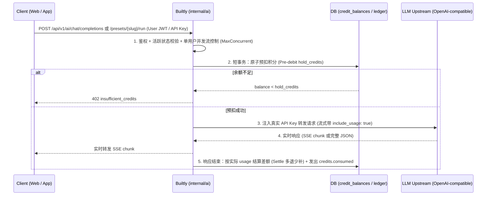

# Builtly AI Gateway — 架构设计与功能规范

| | |
|---|---|
| 状态 | **Approved for implementation** (v0.2, 2026-10-31) |
| 定位 | `docs/architecture.md` §3.8 / §4.8 的演进实现：内置多租户 OpenAI 兼容 LLM 安全代理、流式 SSE 透传、积分预扣/结算与 Prompt 模板保护（无客户端 Token 暴露，零外部缓存依赖） |
| 适用客户端 | 纯静态站点（Jekyll / SPA 浏览器直连）、iOS / Android 原生 App、租户自有后端 |

---

## 0. 核心定位与设计决策

### 0.1 为什么全部由 Builtly 服务端代理？
Builtly 客户端主要为纯静态页面与 App，没有独立服务器：
1. **防 API Key 泄露**：OpenAI 兼容厂商均不支持签发限制单次额度/用户的临时客户端 Token，API Key 放在前端等于完全公开。
2. **防积分刷穿**：前端上报用量不可信；服务端代理可在请求前原子预验/预扣积分，流结束前按实际 Token 结算。
3. **保护核心资产（System Prompt）**：业务调优的 Prompt 存放在服务端 Preset 模板中，前端只传变量。
4. **天然利用上游 Prompt Caching**：服务端将固定 System Prompt 与模板前置，自动触发 DeepSeek / OpenAI / Anthropic 官方前缀缓存（输入 Token 降本 50%~90%），Builtly **无需自建复杂有风险的响应缓存**。

### 0.2 主流程



---

## 1. 凭据与多租户配置

### 1.1 `openai_compatible` 连接类型
复用 `connections` 与 `app_integrations`（Shared 共享级别）：
- `provider`: `openai_compatible`
- `settings`: `{"base_url": "https://api.openai.com/v1", "default_model": "gpt-4o-mini", "allowed_models": ["gpt-4o-mini", "gpt-4o"]}`
- `secrets_enc`: AES-256-GCM 加密存储 `{"api_key": "sk-..."}`
- 环境变量回退：`BUILTLY_LLM_BASE_URL`, `BUILTLY_LLM_API_KEY`, `BUILTLY_LLM_DEFAULT_MODEL`

### 1.2 App 级 AI 设置（`apps.settings.ai`）
```jsonc
{
  "ai": {
    "enabled": true,
    "allow_direct_chat": true,              // false = 仅允许调用后台配置的 presets
    "max_concurrent_per_user": 2,           // 单用户进行中的流式并发数上限
    "max_context_messages": 40,             // 限制上传历史消息条数
    "default_max_tokens": 2048,             // 未传 max_tokens 时的预扣基准
    "pricing": {
      "mode": "per_request",                // per_request (固定扣积分) | per_token (按 token 阶梯折算)
      "default_credits_per_request": 1,
      "models": {
        "gpt-4o-mini": {
          "credits_per_request": 1,
          "input_credits_per_1k": 1,
          "output_credits_per_1k": 3,
          "min_credits": 1
        }
      }
    }
  }
}
```

---

## 2. 数据库设计（`0005_ai_presets.sql`）

```sql
CREATE TABLE ai_presets (
    id                    UUID PRIMARY KEY,
    app_id                UUID NOT NULL REFERENCES apps(id),
    slug                  TEXT NOT NULL,                 -- [a-z0-9_-]{1,64}
    name                  TEXT NOT NULL,
    description           TEXT NOT NULL DEFAULT '',
    model                 TEXT NOT NULL,
    system_prompt         TEXT NOT NULL DEFAULT '',      -- 支持 {{{VAR}}} 变量
    user_prompt_template  TEXT NOT NULL DEFAULT '',      -- 可选模板，支持 {{{VAR}}}
    temperature           DOUBLE PRECISION NOT NULL DEFAULT 0.7,
    max_tokens            INTEGER NOT NULL DEFAULT 2048,
    response_format       TEXT NOT NULL DEFAULT 'text',  -- text | json_object
    credits_cost          BIGINT NOT NULL DEFAULT 1 CHECK (credits_cost >= 0),
    published             BOOLEAN NOT NULL DEFAULT TRUE,
    created_at            TIMESTAMPTZ NOT NULL,
    updated_at            TIMESTAMPTZ NOT NULL,
    CONSTRAINT uq_ai_presets_app_slug UNIQUE (app_id, slug)
);
CREATE INDEX idx_ai_presets_app ON ai_presets (app_id, created_at DESC);
```

---

## 3. 积分预扣与结算算法（Pre-debit & Settle）

无需增加死锁风险高的临时冻结表，复用现有账本短事务：

1. **预扣（Pre-debit，发起请求前，~1ms 短事务）**：
   - 确定预扣金额 `hold = (per_request 模式) ? model.credits_per_request : ceil(估算输入*input_rate + max_tokens*output_rate)`。
   - 调用 `credit.Service.Consume`（原子判断 `balance >= hold` 并扣减），写入账本 `entry_type = 'ai_consume'`, `idempotency_key = "ai:<user_id>:<req_id>"`, `reference_type = "ai_request"`。
   - 余额不足返回 `402 insufficient_credits`。
2. **结算（Settle，流结束或异常中断后，~1ms 短事务）**：
   - **上游连接失败 / 5xx / 429 且未产出任何 Token**：调用 `credit.Service.ApplyTx` 写入正向补偿 `entry_type = 'refund_reversal'`, `idempotency_key = "ai_settle:<user_id>:<req_id>"`, 全额返还 `hold`。
   - **`per_request` 模式且成功**：无后续 DB 写操作，阶段一已扣准。
   - **`per_token` 模式成功（或客户端主动中断）**：根据上游返回的 `usage`（或中断前已传输字符折算的 output tokens）计算实际 `actual`：
     - 若 `actual < hold`：正向退还差额 `hold - actual`；
     - 若 `actual > hold`：补扣差额 `actual - hold`。

---

## 4. 核心 API 契约

| 方法 | 路径 | 认证 | 说明 |
|---|---|---|---|
| POST | `/api/v1/ai/chat/completions` | User JWT \| API Key | OpenAI 兼容聊天接口，支持 stream: true/false |
| POST | `/api/v1/ai/presets/{slug}/run` | User JWT \| API Key | 运行后台配置的 AI Preset 模板（隐藏 System Prompt） |
| POST | `/api/v1/ai/consume` | User JWT \| API Key | 保留现有纯扣费接口供自建后端使用 |
| GET, POST | `/api/v1/admin/apps/{app_id}/ai-presets` | Admin Token | 管理 App 的 AI Presets |
| GET, PATCH, DELETE | `/api/v1/admin/apps/{app_id}/ai-presets/{id}` | Admin Token | 读写单条 Preset |
| POST | `/api/v1/admin/connections/{id}/test-llm` | Admin Token | 测试 LLM 连通性 |

### 4.1 `POST /api/v1/ai/chat/completions`
- 与标准 OpenAI 请求体兼容（`model`, `messages`, `temperature`, `max_tokens`, `stream` 等）。
- 响应头注入元数据：
  - `X-Builtly-Credits-Charged: 1`
  - `X-Builtly-Balance-Remaining: 245`

### 4.2 `POST /api/v1/ai/presets/{slug}/run`
```json
{
  "variables": {
    "DOCUMENT": "..."
  },
  "stream": true
}
```
服务端将 `variables` 渲染入 `system_prompt` 与 `user_prompt_template`，使用预设配置的模型与参数向上游发起请求。

---

## 5. Web Admin 管理端流

遵循 App-first 模式，在左侧导航加入 **AI** 菜单（`#/apps/{app_id}/ai`）：
1. **Platform → Connections**：支持创建/配置 `openai_compatible` 连接并提供 **Test** 连通性测试。
2. **App → Integrations**：支持将 `openai_compatible` 绑定给当前 App。
3. **App → AI**：
   - 顶部提供 App 级策略开关（是否允许 Direct Chat、并发限制、价格表）；
   - 下方提供 **Presets 列表** 与弹窗编辑器（名称、slug、模型、System Prompt、变量定义、单次积分价格），并支持在线直接试跑预览。
