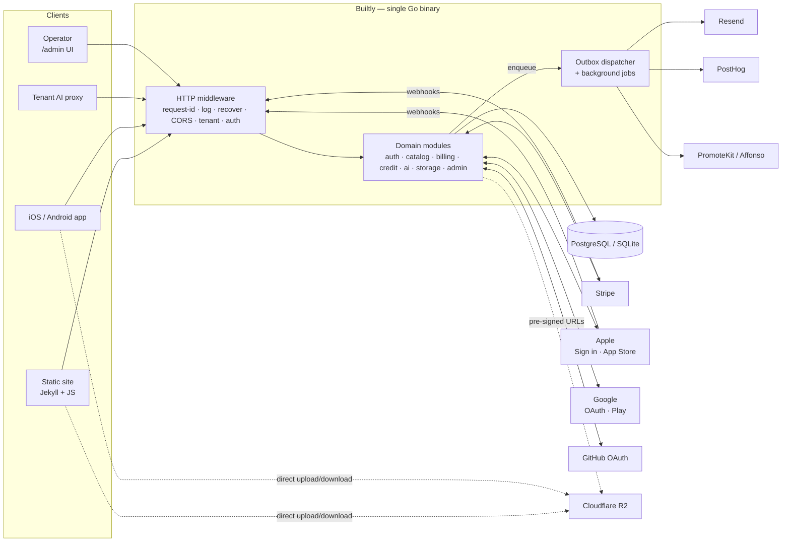
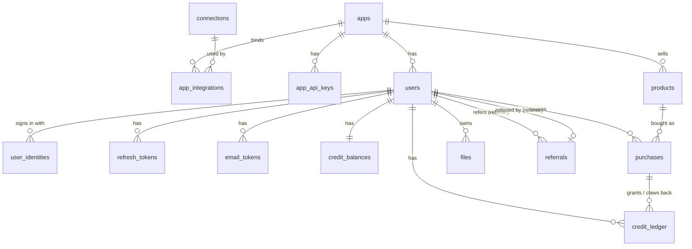
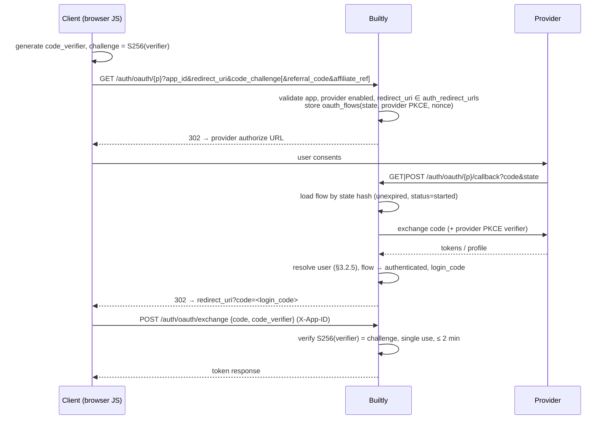
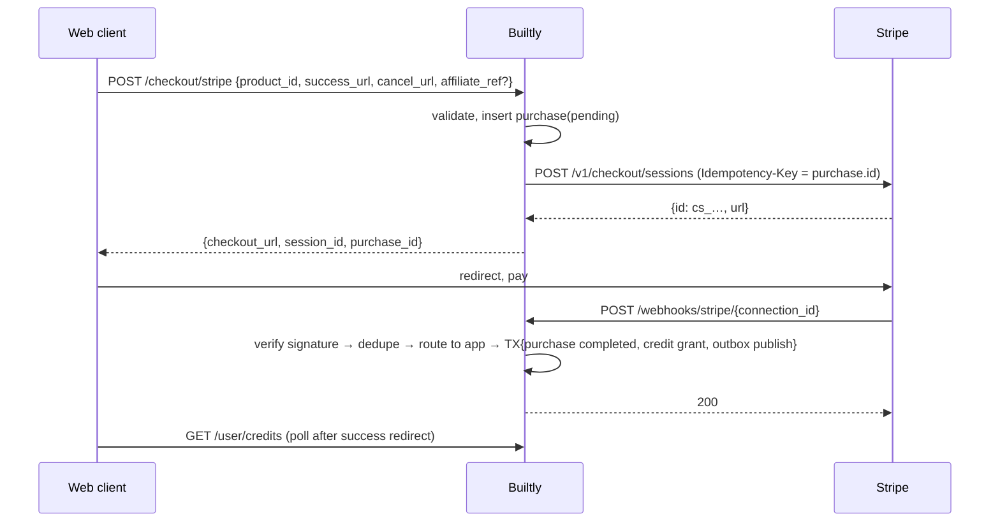
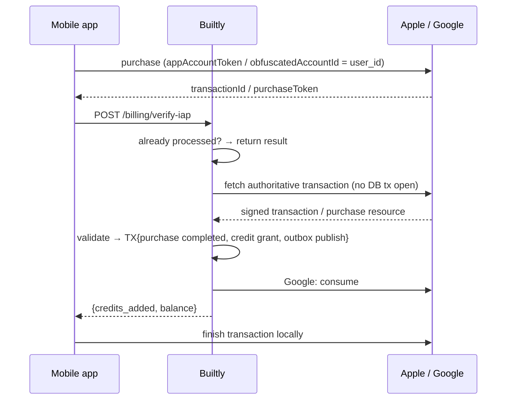
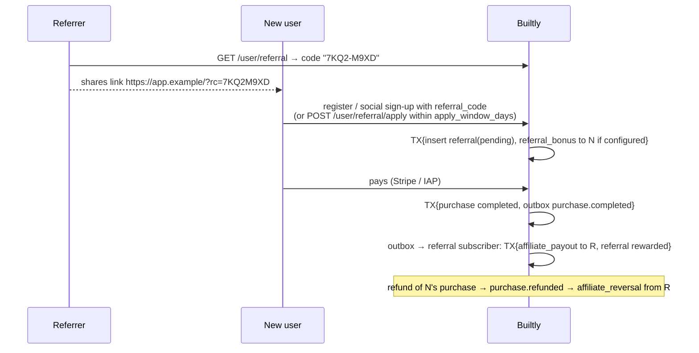

# Builtly — Architecture Design & Functional Specification

| | |
|---|---|
| Status | **Draft for review** (v0.3, 2026-10-28) |
| Audience | Maintainers (approval) and downstream coding agents (implementation) |
| Scope | v1: multi-tenant auth (email, Google, GitHub, Apple), credit catalog, Stripe (one isolated Stripe account per app) + Apple/Google IAP with refunds, credit ledger and AI metering, user-to-user referral rewards in credits, transactional email, R2 file storage, PostHog + affiliate hooks, embedded admin dashboard |

This document is normative. **MUST**, **MUST NOT**, **SHOULD**, **MAY** follow RFC 2119. When code and this document disagree, fix one of them in the same change — never leave them divergent. Statements marked **⚠ verify** describe third-party behavior that the implementing agent MUST confirm against the vendor's current documentation before coding.

**Reading order**: §0 gives the whole picture. §1 explains the runtime structure (tenancy, secrets, admin UI, code layout). §2 defines the data. §3 walks through each integration's workflow. §4 is the endpoint-by-endpoint contract. §5 is the rulebook and build plan for implementing agents.

---

## 0. Overview

### 0.1 What Builtly is

Builtly is a **single Go binary** that gives many independent client applications ("apps", i.e. tenants) a shared backend:

| Capability | What it provides |
|---|---|
| **Identity** | Per-app accounts via email/password, Google, GitHub and Sign in with Apple; one unified JWT session model; email verification, password reset, account deletion |
| **Monetization** | Per-app catalog of credit packs, sold through Stripe Checkout (web) or Apple/Google in-app purchase (mobile); refunds claw credits back |
| **Credits** | An append-only ledger as the single source of truth for balances; an atomic, idempotent check-and-deduct endpoint for metering AI usage |
| **Referrals** | Per-user referral codes; referrers earn credits when referred users pay (rules configurable per app) |
| **Files** | Per-app, per-user file storage on Cloudflare R2 via pre-signed URLs |
| **Growth hooks** | Server-side PostHog events and affiliate (PromoteKit / Affonso) conversion tracking on paid conversions |
| **Operations** | An embedded `/admin` dashboard and admin API for apps, integration credentials, API keys, products, users and ledgers |

Clients are static sites (e.g. Jekyll calling the REST API from browser JS) and native iOS/Android apps. A tenant's own servers (e.g. its AI proxy) MAY call Builtly with an app API key. Client-side-only tools (Google Analytics, AdSense, Crisp / Tawk.to) live entirely in the frontends and are **not** part of Builtly.

### 0.2 System context



### 0.3 Main flows

| # | Flow | Path through the system | Spec |
|---|---|---|---|
| F1 | Email sign-up / sign-in | client → tenant mw → `auth` → signup bonus via `credit` → verification mail via outbox → Resend | §3.2, §3.3 |
| F2 | Social sign-in | browser redirect or native SDK → `auth` verifies provider identity → same session issuance as F1 | §3.2 |
| F3 | Web purchase | `billing` creates Stripe Checkout Session → user pays → Stripe webhook → `credit` grant → outbox → PostHog / affiliate | §3.5 |
| F4 | Mobile purchase | native IAP → `billing/verify-iap` → Apple/Google API → `credit` grant → outbox | §3.6 |
| F5 | Refund | Stripe webhook / Apple notification / Google voided-purchases poll → `credit` clawback → outbox | §3.7 |
| F6 | AI usage | client or tenant proxy → `ai/consume` → `credit` atomic deduct | §3.8 |
| F7 | File upload | client asks for pre-signed PUT → uploads to R2 directly → confirms → `storage` verifies | §3.4 |
| F8 | Referral reward | new user signs up with a referral code → later pays → outbox → `referral` grants credits to the referrer | §3.11 |
| F9 | Administration | operator → `/admin` (embedded UI) → admin API → modules | §1.4 |

### 0.4 Key decisions (and deviations from the brief)

| Decision | Rationale |
|---|---|
| **Connections model for credentials**: a credential set (Stripe account, Resend key, OAuth client, …) is a *connection*; apps *bind* to connections | One mechanism for every provider. Infrastructure credentials (Resend, R2, PostHog, OAuth clients) MAY be shared by many apps. |
| **Payment connections are exclusive: one Stripe account per app** (likewise one App Store / Play app per tenant) | Hard isolation of money flows, webhooks, prices and payouts. With one Stripe login, the operator creates a separate Stripe *account* per app inside the same organization; each has its own keys and webhook endpoints. Enforced by unique indexes (§2.3). |
| **Env fallback**: credentials in env become a built-in `default` connection per provider, used when an app has no binding | Self-hosters can run single-tenant with only `.env`; multi-tenant operators configure everything in the DB. Exclusive providers never fall back implicitly (§1.3.2). |
| **Webhook paths are `/webhooks/{provider}/{connection_id}`** (brief: `/webhooks/stripe`) | The signing secret must be known before the payload is trusted, so the connection must come from the URL; because Stripe connections are exclusive, the connection also identifies the app. |
| **Two separate growth mechanisms**: internal *referral program* (user-to-user codes, rewards in credits) and external *affiliates* (PromoteKit / Affonso, cash commissions handled by them) | Different owners, currencies and abuse models; they share no code or fields. The `affiliate_payout` ledger type is the referral program's credit reward. |
| **sqlx + `database/sql`**, not GORM; pure-Go drivers (`pgx/v5`, `modernc.org/sqlite`) | Explicit, reviewable SQL for tenant filters and atomic credit statements; `CGO_ENABLED=0` static binary. |
| **No in-process mutex for credits** | Correctness must hold with N instances; the database is the only lock. |
| **Refunds claw back full credits; balances may go negative** | Prevents "buy → spend → refund". A negative balance blocks consumption until topped up. |
| **Side effects through a transactional outbox** (email, PostHog, affiliate, Apple token revoke, file purge) | Payment/auth transactions never fail or block because a third party is slow; deliveries are retried and visible in `/admin`. |
| **Hand-written thin clients** for Stripe, Resend, PostHog, affiliates and an **S3 SigV4 signer** for R2 (no stripe-go / aws-sdk) | Each integration uses 1–5 endpoints; keeps the dependency graph tiny. SigV4 is verified against AWS test vectors. |
| **Domain-modular layout** (`internal/<module>/{handler,service,store}.go`) instead of top-level `handler/`, `service/`, `repository/` folders | Same layering, but everything about one domain lives in one package (high cohesion, no cross-package anemic models). Mapping in §1.5. |
| **Admin UI is build-free** (vanilla ES modules + vendored Pico.css / Alpine.js CSP), embedded with `go:embed` | `go build` alone produces the full product; no Node toolchain or CDN at runtime. |
| Apple IAP uses the **App Store Server API**, not deprecated `verifyReceipt`; endpoint renamed to `/billing/verify-iap` per brief | Apple's supported path returns signed (JWS) transactions. |

### 0.5 Out of scope for v1

Subscriptions / recurring plans; anonymous accounts; explicit link/unlink of social identities by the user (v1 links automatically by verified email, §3.2.5); multiple admin users / RBAC (single master token); Google Play RTDN via Pub/Sub (v1 polls the Voided Purchases API); Sign in with Apple server-to-server notifications; Postgres row-level security; the AI request forwarding itself (Builtly only meters); multi-region.

---

## 1. System Architecture & Embedded Admin UI

### 1.1 Request lifecycle

```
http.Server
 └─ chi.Router
     ├─ RequestID     accept inbound X-Request-ID if well-formed, else generate (UUIDv7); echo in response
     ├─ RealIP        honors X-Forwarded-For only from BUILTLY_TRUSTED_PROXIES
     ├─ AccessLog     slog, one line per request
     ├─ Recoverer     panic → 500 internal (stack logged)
     ├─ SecHeaders    nosniff, Referrer-Policy, Cache-Control: no-store (overridable)
     ├─ BodyLimit     64 KiB default; 1 MiB for webhooks
     │
     ├─ GET  /healthz, /readyz                                     no tenant
     ├─ GET  /admin/*                                              embedded static UI (§1.4)
     ├─ /api/v1/admin/*            AdminAuth (master token)        no tenant header
     ├─ /api/v1/webhooks/{provider}/{connection_id}               signature-authenticated, tenant from payload
     ├─ GET|POST /api/v1/auth/oauth/{provider}[/callback]         tenant from query (?app_id) / OAuth state (§3.2)
     └─ /api/v1/*                  CORS + Tenant (X-App-ID)
          ├─ public:   auth/*, products
          └─ Authenticate (user JWT | app API key)
               ├─ user:            user/*, checkout/stripe, billing/verify-iap, files/*
               └─ user | API key:  ai/consume
```

### 1.2 Multi-tenant isolation

#### 1.2.1 Identifying the tenant

- Every app has an immutable `apps.id` (UUID). It is **public** — it ships in web pages and app binaries — and is sent as **`X-App-ID: <uuid>`**.
- `X-App-ID` *identifies*; it never *authenticates*. Authentication is the user JWT, the app API key, the admin token, or a provider signature.
- Exceptions where a header cannot be set, each with its own source of the app ID:

  | Route | App source |
  |---|---|
  | `GET /auth/oauth/{provider}` (browser navigation) | `?app_id=` query parameter |
  | `GET|POST /auth/oauth/{provider}/callback` | Server-side OAuth state row (§3.2.2) |
  | `/webhooks/{provider}/{connection_id}` | Verified payload (`metadata.app_id`, bundle ID), restricted to apps bound to that connection |
  | `/api/v1/admin/*` | Path parameter `{app_id}` |

#### 1.2.2 Tenant middleware (`internal/tenant`)

```
1. Read X-App-ID. Missing → 400 missing_app_id. Not a UUID → 400 invalid_app_id.
2. tenant.Service.Get(ctx, id) — in-memory cache (TTL 30 s; invalidated on admin writes on this instance).
3. Not found → 404 app_not_found. status = suspended → 403 app_suspended.
4. If the request carries Origin and it is not in app.settings.allowed_origins → 403 origin_not_allowed.
5. ctx = tenant.WithApp(ctx, app)
```

Handlers call `tenant.FromContext(ctx)` once and pass `app.ID` **explicitly** to services. Services never read the tenant from the context.

#### 1.2.3 Binding identity to the tenant

- **User JWT**: `aud` = app ID. `Authenticate` rejects `aud ≠ X-App-ID` with 401. Tokens from app A are useless in app B even though the signing key is shared.
- **App API key**: belongs to one app; key's `app_id ≠ X-App-ID` → 401.
- **Users** are unique per `(app_id, email)` and per `(app_id, provider, provider_subject)`. The same person in two apps is two unrelated accounts.

#### 1.2.4 CORS

A browser preflight carries the header *name* `X-App-ID` but not its value, so preflight cannot be app-specific:

- **Preflight**: allowed if `Origin` is in the union of `allowed_origins` of all active apps (cached, 30 s). Respond with the echoed origin (never `*`), `Allow-Headers: Authorization, Content-Type, X-App-ID, Idempotency-Key, X-Request-ID`, `Allow-Methods: GET, POST, PUT, PATCH, DELETE, OPTIONS`, `Max-Age`, `Vary: Origin`.
- **Actual request**: tenant middleware enforces the app's own list (step 4).
- No cookies are used anywhere in the API, so `Allow-Credentials` is never set and CSRF does not apply.
- `/api/v1/admin/*` sends no CORS headers: the admin UI is same-origin.

#### 1.2.5 Enforcement in the data layer (defense in depth)

1. **Signature**: every store method on a tenant-owned table takes `appID uuid.UUID` right after `ctx` and the querier. No "get by id" without `appID`.
   ```go
   func (s *Store) GetByEmail(ctx context.Context, q db.Querier, appID uuid.UUID, email string) (User, error)
   ```
2. **SQL**: every statement on a tenant-owned table filters or sets `app_id`. A test (`internal/platform/db/tenantlint_test.go`) scans each store's SQL constants and fails if a statement on a tenant-owned table lacks `app_id`.
3. **Schema**: child tables reference parents with **composite foreign keys** `(app_id, user_id) → users(app_id, id)`, so the database rejects cross-tenant rows.

Admin handlers use the same store methods with the `{app_id}` path parameter — there is no "god mode" query path.

### 1.3 App settings & secret store

#### 1.3.1 Three kinds of configuration

| Kind | Where | Examples | Mutability |
|---|---|---|---|
| **Process config** | env / `.env` (§5.6) | DB DSN, JWT signing keys, encryption keys, admin token, public URL | Restart |
| **App settings** (non-secret) | `apps.settings` JSON | allowed origins, redirect URLs, signup bonus, email sender, storage limits, feature toggles | Admin API, live |
| **Connections** (secret) | `connections` table, secrets AES-GCM encrypted | Stripe keys, Resend key, R2 keys, OAuth client secrets, Apple keys, PostHog key | Admin API, live |

#### 1.3.2 Connections and bindings

A **connection** is one credential set for one provider. An **app binding** says "app X uses connection C for provider P", optionally with per-app binding settings.

```
connections                            app_integrations
┌─────────────────────────────────┐    ┌─────────────────────────────────────────────┐
│ c1 stripe "Acme (acct_1Ab…)"    │◄───│ app A · stripe · c1          exclusive      │
│ c2 stripe "Beta (acct_9Xy…)"    │◄───│ app B · stripe · c2          exclusive      │
│ c3 resend "Platform mail"       │◄─┬─│ app A · resend · c3          shared         │
│ c4 r2     "assets"              │◄┐└─│ app B · resend · c3          shared         │
└─────────────────────────────────┘ ├──│ app A · r2     · c4 {key_prefix:"acme"}     │
                                    └──│ app B · r2     · c4 {key_prefix:"beta"}     │
                                       └─────────────────────────────────────────────┘
```

**Provider classes**

| Class | Providers | Rule |
|---|---|---|
| **Exclusive** | `stripe`, `apple_iap`, `google_play` | A connection serves **at most one app**. No implicit env fallback: an app uses the env `default` connection only through an explicit binding, and at most one app may hold that binding. Enforced in the DB (§2.3), not only in code. |
| **Shared** | `resend`, `r2`, `google_oauth`, `github_oauth`, `apple_signin`, `posthog`, `promotekit`, `affonso` | Any number of apps may bind the same connection; implicit env fallback applies. |

**Resolution** (`integration.Resolver.For(ctx, appID, provider)`):

1. the app's binding for that provider → its connection (or the env `default` connection if the binding says so);
2. else, for **shared** providers only, the env-defined **`default`** connection, if configured (§5.6);
3. else `ErrNotConfigured` → endpoints return **422 `integration_not_configured`**; outbox subscribers for that provider skip silently (`status = skipped`).

The reverse lookup `integration.Resolver.AppForConnection(ctx, provider, connectionID)` returns the single app bound to an exclusive connection; webhooks use it (§3.5, §3.7).

Resolved, decrypted connections are cached in memory for 60 s (invalidated on admin writes on the same instance; other instances converge within the TTL).

**Providers and their config** (`settings` is stored in clear; `secrets` is encrypted and write-only):

| Provider | `settings` | `secrets` | Binding settings |
|---|---|---|---|
| `stripe` | `livemode`, `account_id` (filled by Builtly from `GET /v1/account`) | `secret_key`, `webhook_secrets[]` | — |
| `resend` | — | `api_key` | — |
| `r2` | `account_id`, `bucket`, `public_base_url?` | `access_key_id`, `secret_access_key` | `key_prefix` (default: app ID) |
| `google_oauth` | `client_id` (Web application), `ios_client_id`, `android_client_id`; optional legacy `native_client_ids[]` merged into the native audience list | `client_secret` (Web only; pairs with `client_id`) | — |
| `github_oauth` | `client_id` | `client_secret` | — |
| `apple_signin` | `team_id`, `key_id`, `services_id` (web), `bundle_ids[]` (native) | `private_key_pem` | — |
| `apple_iap` | `issuer_id`, `key_id`, `bundle_id` | `private_key_pem` | — |
| `google_play` | `package_name` | `service_account_json` | — |
| `posthog` | `host` (e.g. `https://us.i.posthog.com`) | `project_api_key` | — |
| `promotekit` / `affonso` | provider-specific (⚠ verify) | `api_key` | — |

Each provider's config is a Go struct with `Validate()`; the admin API rejects invalid shapes with 400.

**Stripe setup per app** (operator guide, ⚠ verify current Dashboard wording): in the Stripe Dashboard's account switcher, create a **new account** for each app inside the same organization (one login, separate accounts). Each account has its own API keys, products/prices, webhook endpoints, branding and payout settings, so events of app A can never reach app B's endpoint. In Builtly, create one `stripe` connection per account and bind it to its app; the admin UI shows the webhook URL `/api/v1/webhooks/stripe/{connection_id}` to register in *that* account. Test mode (or a Stripe sandbox) uses a separate connection with `livemode=false`.

Because the same secret key pasted into two connections would silently break isolation, creating or updating a Stripe connection fetches `GET /v1/account` and stores `settings.account_id`; a second connection with the same `account_id` and `livemode` is rejected with **409 `connection_duplicate`**.

#### 1.3.3 Encryption

- AES-256-GCM, random 12-byte nonce, stored as `nonce || ciphertext` with `key_version`.
- Keys come from `BUILTLY_ENCRYPTION_KEYS` (`version:base64,…`; first = active). Old versions decrypt; `builtly secrets rotate` re-encrypts all rows with the active key.
- Associated data = `connection_id || provider`, so ciphertexts cannot be swapped between rows.
- Plaintext secrets exist only in memory; they are never logged and never returned by any API. Admin reads return masked hints (`"sk_live_…4f2a"`, last 4 chars).

### 1.4 Embedded admin dashboard (`/admin`)

#### 1.4.1 Delivery

```
web/
├── embed.go            // package web; //go:embed all:admin  → var Admin embed.FS
└── admin/
    ├── index.html      // shell; Pico + Alpine CSP + <script type="module" src="app.js">
    ├── app.js          // ES modules: router, views; hydrates Alpine after route renders
    ├── api.js          // Bearer token + apperr handling
    ├── app.css         // admin chrome (sidebar/layout) on top of Pico
    ├── views/*.js      // apps, connections, keys, products, users, referrals, outbox, audit
    └── vendor/         // pico.min.css, alpine.csp.min.js (checked in; no CDN)
```

- Served by `http.FileServerFS(fs.Sub(web.Admin, "admin"))` under `/admin/`, with SPA fallback to `index.html` for unknown sub-paths.
- No bundler, no CDN, no Node build. UI libraries are **vendored** under `admin/vendor/` and embedded. The UI talks only to `/api/v1/admin/*`.
- Alpine uses the **CSP build** (`@alpinejs/csp`) so expressions do not require `'unsafe-eval'`. After `innerHTML` updates, call `Alpine.initTree(el)`.
- Response headers on `/admin/*`: `Content-Security-Policy: default-src 'self'; script-src 'self'; style-src 'self'; img-src 'self' data: https:; connect-src 'self'; frame-ancestors 'none'; base-uri 'none'; form-action 'none'`, `X-Frame-Options: DENY`, `Cache-Control: no-cache` (assets carry an `?v=<build version>` query). `img-src https:` covers OAuth/R2 avatar URLs.
- `BUILTLY_ADMIN_ENABLED=false` removes both the UI and the admin API routes.

#### 1.4.2 Authentication

- A single **master admin token** from `BUILTLY_ADMIN_TOKEN` (≥ 32 random chars; startup fails if shorter while admin is enabled).
- Every admin API call: `Authorization: Bearer <token>`, compared with `subtle.ConstantTimeCompare` against SHA-256 of the configured token (equal-length comparison).
- Optional network restriction `BUILTLY_ADMIN_ALLOWED_CIDRS`; non-matching requests get 404 (route appears absent).
- Failed attempts are rate-limited (5/min per IP) and logged at warn.
- The UI asks for the token on first load and keeps it in `sessionStorage` (cleared when the tab closes). No cookies → no CSRF surface; the strict CSP above is the XSS mitigation that protects the stored token.

#### 1.4.3 Audit

Every mutating admin call writes `admin_audit_log` (action, target, diff with secrets replaced by `"[redacted]"`, IP, request ID) in the same transaction as the change.

#### 1.4.4 Screens

Operator flow is **app-first**: create/select an app (sidebar app switcher), then configure that app. Platform screens manage shared credentials and ops.

| Screen | Functions |
|---|---|
| All apps | list, create (then jump to Integrations) |
| Overview / Integrations / API keys / Products / Email / Users / Activity / Referrals | per selected app; Integrations binds connections + advanced settings JSON. Email holds per-app templates and system-trigger bindings. Activity lists app-wide purchases and the credit ledger |
| Connections | platform credential library by provider group; create/rotate secrets; copy webhook or redirect URL when the provider has one; Resend test send; used-by apps |
| Outbox | filter by status, inspect errors, retry dead deliveries |
| Audit log | filter by app / action |

Sidebar: **Current app** switcher → app nav → Platform (All apps, Connections, Outbox, Audit).

### 1.5 Directory structure

```
builtly/
├── cmd/builtly/main.go          # subcommands: serve | migrate | secrets rotate | credits reconcile | version
├── internal/
│   ├── config/                  # env + .env loading → typed, validated Config
│   ├── server/                  # composition root: wiring, router, http.Server, workers lifecycle
│   ├── apperr/                  # Error{Code, Status, Message, Details} + codes
│   ├── platform/                # infrastructure only, no business rules
│   │   ├── db/                  # Open, Querier, WithTx, Rebind, error mapping, dbtest/
│   │   ├── httpx/               # DecodeJSON, WriteJSON, WriteError, cursors, client IP
│   │   ├── logx/                # slog setup, ctx logger, redaction
│   │   ├── secrets/             # AES-GCM sealing, random tokens, hashing
│   │   ├── jwks/                # cached JWKS fetch + JWT verification for Google/Apple ID tokens
│   │   ├── s3sig/               # AWS SigV4 signing + presigning (R2)
│   │   └── ratelimit/           # in-memory token buckets
│   ├── tenant/                  # apps + settings, Tenant middleware, CORS origin cache, API keys
│   ├── integration/             # connections, app bindings, Resolver, env default connections
│   ├── auth/                    # users, identities, passwords, JWT, refresh tokens, email tokens
│   │   └── provider/            # google/, github/, apple/ — OAuth/OIDC adapters behind one interface
│   ├── credit/                  # credit_balances + credit_ledger — the ONLY writer
│   ├── catalog/                 # products
│   ├── billing/                 # purchases, webhook_events, checkout, IAP, refunds, Google voided poller
│   │   ├── stripeapi/           # minimal Stripe client + webhook signature
│   │   ├── appstore/            # App Store Server API + JWS chain verification + notifications V2
│   │   └── playstore/           # Google Play Developer API
│   ├── ai/                      # POST /ai/consume
│   ├── storage/                 # files, quotas, R2 pre-signing
│   ├── email/                   # templates (embedded) + Resend client; outbox subscriber
│   ├── analytics/               # PostHog client; outbox subscriber
│   ├── affiliate/               # PromoteKit / Affonso adapters; outbox subscriber
│   ├── referral/                # referral codes, referrals, reward rules; outbox subscriber
│   ├── outbox/                  # outbox table, Publish, dispatcher, retry policy
│   └── admin/                   # admin auth middleware, admin HTTP handlers, audit log
├── web/                         # embedded admin UI (§1.4.1)
├── migrations/                  # embed.go + postgres/NNNN_*.sql + sqlite/NNNN_*.sql
├── docs/architecture.md
├── Dockerfile                   # multi-stage, CGO_ENABLED=0, alpine:3.24
├── docker-compose.yml           # Builtly + postgres (+ test service)
├── .env.example
└── go.mod
```

**Mapping to the brief's layered names**: `handler` = `internal/<module>/handler.go`, `service` = `service.go`, `repository` = `store.go`. Each module also has `model.go` (types) and `errors.go` (module `apperr` values). `admin/` holds only admin HTTP handlers; they call the owning module's service (e.g. `credit.Service.Adjust`), never its store.

#### 1.5.1 Dependency rules

```
admin ──────► tenant, integration, catalog, auth, credit, billing, referral, outbox
billing ────► credit, catalog, tenant, integration, outbox
auth ───────► credit, tenant, integration, outbox, referral (apply code at sign-up)
referral ───► credit, tenant, outbox
storage ────► tenant, integration
ai ─────────► credit
email, analytics, affiliate ──► integration   (they subscribe to outbox topics; nobody imports them)
credit, outbox, integration ──► platform only
```

- No import cycles. A module MUST NOT query another module's tables.
- Cross-module **atomicity**: the caller opens `db.WithTx`, then passes `tx` to the other service's `…Tx` method (e.g. `credit.Service.ApplyTx(ctx, tx, entry)`, `outbox.PublishTx(ctx, tx, event)`).
- Producers publish **domain events** (`purchase.completed`); they never import consumers. `internal/server` registers subscribers (`email`, `analytics`, `affiliate`, …) for event types at startup.
- `internal/server` is the only composition root (manual DI; no globals; no DI framework).

### 1.6 Background workers

`builtly serve` runs these goroutines alongside the HTTP server (disabled with `BUILTLY_WORKERS_ENABLED=false`, e.g. for API-only replicas). All are safe to run on every instance concurrently.

| Worker | Interval | Mechanism for multi-instance safety |
|---|---|---|
| Outbox dispatcher | continuous (poll 1 s when idle) | Row claim with lease (§3.9) |
| Google voided-purchases poller | 1 h per `google_play` connection | Idempotent ledger keys; cursor in `job_state` |
| Cleanup | 1 h | Idempotent deletes: expired `oauth_flows`, `email_tokens`, refresh tokens (> 30 days past expiry), `pending` files older than 24 h, `pending` purchases older than 48 h → `expired` |

On shutdown, workers stop claiming new work and finish the current item within `BUILTLY_SHUTDOWN_TIMEOUT`.

---

## 2. Database Schema Design

### 2.1 Conventions

| Topic | Rule |
|---|---|
| Dialects | PostgreSQL 15+ (production) and SQLite 3.40+ (dev / small self-hosted). Two migration folders kept semantically identical. Both support `ON CONFLICT`, `RETURNING`, partial indexes. |
| IDs | UUIDv7 generated in Go. PG `UUID`; SQLite `TEXT`. |
| Time | UTC always. PG `TIMESTAMPTZ`; SQLite `TEXT` (RFC 3339, ms). Set from Go, never DB defaults. |
| Credits / money | `BIGINT`. Credits are whole units; money is minor units + ISO-4217 lowercase `currency`. Never floats. |
| JSON | PG `JSONB`; SQLite `TEXT`. Typed structs in Go. |
| Secrets at rest | `BYTEA` / `BLOB` sealed by `platform/secrets`. Hashes (tokens, keys) are SHA-256 `BYTEA`. |
| Enums | `TEXT` + `CHECK (… IN (…))`; typed string constants in Go. |
| Booleans | PG `BOOLEAN`; SQLite `INTEGER` 0/1. |
| Deletion | No hard delete of users, products, purchases, ledger. Status columns instead. Ephemeral tables (flows, tokens, outbox `done` rows after 30 days) are purged by cleanup. |
| Migrations | Forward-only `NNNN_description.sql`, embedded, applied by `builtly migrate up`, tracked in `schema_migrations(version, applied_at)`, one transaction per file. `serve` refuses to start if migrations are pending (unless `BUILTLY_AUTO_MIGRATE=true`). |

DDL below is PostgreSQL. The SQLite version substitutes types as above.

### 2.2 Entity overview



Supporting tables without tenant-facing relations: `oauth_flows`, `webhook_events`, `outbox`, `job_state`, `admin_audit_log`, `schema_migrations`.

### 2.3 Tenancy & configuration

```sql
CREATE TABLE apps (
    id          UUID PRIMARY KEY,
    slug        TEXT NOT NULL UNIQUE,                 -- [a-z0-9-]{3,40}
    name        TEXT NOT NULL,
    status      TEXT NOT NULL DEFAULT 'active' CHECK (status IN ('active', 'suspended')),
    settings    JSONB NOT NULL DEFAULT '{}',          -- tenant.Settings, see below
    created_at  TIMESTAMPTZ NOT NULL,
    updated_at  TIMESTAMPTZ NOT NULL
);

CREATE TABLE connections (
    id           UUID PRIMARY KEY,
    provider     TEXT NOT NULL CHECK (provider IN ('stripe', 'resend', 'r2', 'google_oauth', 'github_oauth',
                     'apple_signin', 'apple_iap', 'google_play', 'posthog', 'promotekit', 'affonso')),
    name         TEXT NOT NULL,
    settings     JSONB NOT NULL DEFAULT '{}',         -- non-secret
    secrets_enc  BYTEA NOT NULL,                      -- sealed JSON
    key_version  INTEGER NOT NULL,
    created_at   TIMESTAMPTZ NOT NULL,
    updated_at   TIMESTAMPTZ NOT NULL
);
CREATE INDEX idx_connections_provider ON connections (provider);

CREATE TABLE app_integrations (
    app_id         UUID NOT NULL REFERENCES apps(id),
    provider       TEXT NOT NULL,
    connection_id  UUID NULL REFERENCES connections(id),       -- NULL = explicit binding to the env 'default'
                                                                -- RESTRICT: cannot delete a used connection
    settings       JSONB NOT NULL DEFAULT '{}',                 -- binding settings, e.g. r2 key_prefix
    created_at     TIMESTAMPTZ NOT NULL,
    updated_at     TIMESTAMPTZ NOT NULL,
    PRIMARY KEY (app_id, provider)
);
CREATE INDEX idx_app_integrations_conn ON app_integrations (connection_id);
-- Exclusive providers: one app per connection, and at most one app on the env default.
CREATE UNIQUE INDEX uq_app_integrations_exclusive ON app_integrations (provider, connection_id)
    WHERE provider IN ('stripe', 'apple_iap', 'google_play') AND connection_id IS NOT NULL;
CREATE UNIQUE INDEX uq_app_integrations_exclusive_default ON app_integrations (provider)
    WHERE provider IN ('stripe', 'apple_iap', 'google_play') AND connection_id IS NULL;
-- service layer enforces app_integrations.provider = connections.provider
-- and connections(provider='stripe') unique on (settings.account_id, settings.livemode) (§1.3.2)

CREATE TABLE app_api_keys (
    id            UUID PRIMARY KEY,
    app_id        UUID NOT NULL REFERENCES apps(id),
    name          TEXT NOT NULL,
    prefix        TEXT NOT NULL,                      -- first 12 chars for display
    key_hash      BYTEA NOT NULL UNIQUE,              -- SHA-256 (keys are 256-bit random)
    scopes        JSONB NOT NULL DEFAULT '["credits:consume"]',
    last_used_at  TIMESTAMPTZ NULL,                   -- updated at most once per minute
    revoked_at    TIMESTAMPTZ NULL,
    created_at    TIMESTAMPTZ NOT NULL
);
CREATE INDEX idx_app_api_keys_app ON app_api_keys (app_id);
```

`apps.settings` (`tenant.Settings`, validated on write):

```jsonc
{
  "allowed_origins":       ["https://acme.com"],            // CORS + Stripe success/cancel origin allowlist
  "auth_redirect_urls":    ["https://acme.com/auth/callback", "acme://auth"],  // exact-match OAuth return targets
  "auth": {
    "password_enabled":           true,
    "providers":                  ["google", "github", "apple"],
    "require_email_verification": false   // true → unverified password users get 403 email_not_verified on login
  },
  "signup_bonus_credits":  10,
  "allow_iap_sandbox":     false,   // test app: accept every Apple sandbox / Google test purchase
  "iap_sandbox_emails":    [],      // production: Builtly account emails allowed when the flag is false
  "email": {
    "from_name": "Acme", "from_address": "no-reply@mail.acme.com", "reply_to": "",
    "action_base_url": "https://acme.com/account"     // links: {base}/verify?token=…, {base}/reset?token=…
  },
  "storage": {
    "max_file_bytes":        10485760,
    "user_quota_bytes":      104857600,
    "allowed_content_types": ["image/png", "image/jpeg", "image/webp", "application/pdf"]
  },
  "analytics": { "capture_consume_events": false },
  "affiliate": { "provider": "none" },                // none | promotekit | affonso (external, cash)
  "referral": {                                       // internal, credits (§3.11)
    "enabled":                  false,
    "trigger":                  "first_purchase",     // first_purchase | every_purchase
    "reward_type":              "percent",            // percent (of the purchase's credits) | fixed
    "reward_value":             10,                   // percent: 1–100; fixed: credits > 0
    "referee_bonus_credits":    0,                    // extra credits for the new user when a code is applied
    "max_rewarded_referees":    0,                    // per referrer; 0 = unlimited
    "apply_window_days":        7                     // code can be applied up to N days after sign-up
  }
}
```

API key format: `bk_` + base64url(32 random bytes). Shown once.

### 2.4 Identity

```sql
CREATE TABLE users (
    id                 UUID PRIMARY KEY,
    app_id             UUID NOT NULL REFERENCES apps(id),
    email              TEXT NULL,                     -- normalized (trim + lowercase); NULL only for deleted users
    email_verified_at  TIMESTAMPTZ NULL,
    password_hash      TEXT NULL,                     -- argon2id PHC; NULL = no password sign-in
    display_name       TEXT NOT NULL DEFAULT '',
    avatar_url         TEXT NOT NULL DEFAULT '',
    locale             TEXT NOT NULL DEFAULT '',      -- BCP 47 tag; set on register/PATCH
    last_ip            TEXT NOT NULL DEFAULT '',      -- updated on login / token refresh
    status             TEXT NOT NULL DEFAULT 'active' CHECK (status IN ('active', 'disabled', 'deleted')),
    attribution        JSONB NOT NULL DEFAULT '{}',   -- first-touch: {"affiliate_ref":"…","utm_source":"…"}
    referral_code      TEXT NULL,                     -- this user's own code; generated at creation; NULL after deletion
    last_login_at      TIMESTAMPTZ NULL,
    deleted_at         TIMESTAMPTZ NULL,
    created_at         TIMESTAMPTZ NOT NULL,
    updated_at         TIMESTAMPTZ NOT NULL,
    CONSTRAINT uq_users_app_id UNIQUE (app_id, id)    -- target for composite FKs
);
CREATE UNIQUE INDEX uq_users_app_email    ON users (app_id, email)         WHERE email IS NOT NULL;
CREATE UNIQUE INDEX uq_users_app_referral ON users (app_id, referral_code) WHERE referral_code IS NOT NULL;

CREATE TABLE user_identities (
    id                      UUID PRIMARY KEY,
    app_id                  UUID NOT NULL,
    user_id                 UUID NOT NULL,
    provider                TEXT NOT NULL CHECK (provider IN ('google', 'github', 'apple')),
    provider_subject        TEXT NOT NULL,            -- Google/Apple "sub", GitHub numeric id
    email                   TEXT NULL,                -- as asserted by the provider
    email_verified          BOOLEAN NOT NULL,
    provider_refresh_enc    BYTEA NULL,               -- Apple refresh token (needed to revoke on deletion)
    created_at              TIMESTAMPTZ NOT NULL,
    last_used_at            TIMESTAMPTZ NOT NULL,
    CONSTRAINT uq_identity UNIQUE (app_id, provider, provider_subject),
    FOREIGN KEY (app_id, user_id) REFERENCES users (app_id, id)
);
CREATE INDEX idx_identities_user ON user_identities (app_id, user_id);

CREATE TABLE refresh_tokens (
    id           UUID PRIMARY KEY,
    app_id       UUID NOT NULL,
    user_id      UUID NOT NULL,
    family_id    UUID NOT NULL,
    token_hash   BYTEA NOT NULL UNIQUE,
    auth_method  TEXT NOT NULL,                       -- password | google | github | apple
    expires_at   TIMESTAMPTZ NOT NULL,
    revoked_at   TIMESTAMPTZ NULL,
    replaced_by  UUID NULL,
    user_agent   TEXT NOT NULL DEFAULT '',
    ip           TEXT NOT NULL DEFAULT '',
    created_at   TIMESTAMPTZ NOT NULL,
    FOREIGN KEY (app_id, user_id) REFERENCES users (app_id, id)
);
CREATE INDEX idx_refresh_user   ON refresh_tokens (app_id, user_id);
CREATE INDEX idx_refresh_family ON refresh_tokens (family_id);

CREATE TABLE email_tokens (
    id           UUID PRIMARY KEY,
    app_id       UUID NOT NULL,
    user_id      UUID NOT NULL,
    purpose      TEXT NOT NULL CHECK (purpose IN ('verify_email', 'reset_password')),
    email        TEXT NOT NULL,                       -- address the token was sent to
    token_hash   BYTEA NOT NULL UNIQUE,
    expires_at   TIMESTAMPTZ NOT NULL,                -- verify: 24 h, reset: 1 h
    consumed_at  TIMESTAMPTZ NULL,
    created_at   TIMESTAMPTZ NOT NULL,
    FOREIGN KEY (app_id, user_id) REFERENCES users (app_id, id)
);
CREATE INDEX idx_email_tokens_user ON email_tokens (app_id, user_id, purpose);

CREATE TABLE oauth_flows (                            -- server-side OAuth state; no cookies
    id                     UUID PRIMARY KEY,
    app_id                 UUID NOT NULL REFERENCES apps(id),
    provider               TEXT NOT NULL,
    connection_id          TEXT NOT NULL,             -- UUID or 'default'
    state_hash             BYTEA NOT NULL UNIQUE,     -- SHA-256 of the state sent to the provider
    redirect_uri           TEXT NOT NULL,             -- client return target (validated)
    client_code_challenge  TEXT NOT NULL,             -- PKCE S256 from the client (client ↔ builtly)
    provider_verifier_enc  BYTEA NOT NULL,            -- PKCE verifier for builtly ↔ provider
    nonce                  TEXT NOT NULL,             -- OIDC nonce (Google/Apple)
    attribution            JSONB NOT NULL DEFAULT '{}',
    referral_code          TEXT NULL,                 -- applied if the flow creates a new user
    login_code_hash        BYTEA NULL UNIQUE,         -- set after successful callback
    user_id                UUID NULL,
    status                 TEXT NOT NULL CHECK (status IN ('started', 'authenticated', 'exchanged', 'failed')),
    expires_at             TIMESTAMPTZ NOT NULL,      -- started: 10 min; authenticated: 2 min
    created_at             TIMESTAMPTZ NOT NULL
);
```

### 2.5 Catalog, purchases, webhooks

```sql
CREATE TABLE products (
    id                 UUID PRIMARY KEY,
    app_id             UUID NOT NULL REFERENCES apps(id),
    sku                TEXT NOT NULL,                 -- app-defined, e.g. "credits_100"
    name               TEXT NOT NULL,
    description        TEXT NOT NULL DEFAULT '',
    kind               TEXT NOT NULL DEFAULT 'credit_pack' CHECK (kind IN ('credit_pack')),
    credits            BIGINT NOT NULL CHECK (credits > 0),
    price_amount       BIGINT NOT NULL CHECK (price_amount >= 0),   -- display price, minor units
    currency           TEXT NOT NULL,
    stripe_price_id    TEXT NULL,
    apple_product_id   TEXT NULL,
    google_product_id  TEXT NULL,
    active             BOOLEAN NOT NULL DEFAULT TRUE,
    sort_order         INTEGER NOT NULL DEFAULT 0,
    metadata           JSONB NOT NULL DEFAULT '{}',
    created_at         TIMESTAMPTZ NOT NULL,
    updated_at         TIMESTAMPTZ NOT NULL,
    CONSTRAINT uq_products_app_sku UNIQUE (app_id, sku),
    CONSTRAINT uq_products_app_id  UNIQUE (app_id, id)
);
CREATE UNIQUE INDEX uq_products_stripe ON products (app_id, stripe_price_id)   WHERE stripe_price_id   IS NOT NULL;
CREATE UNIQUE INDEX uq_products_apple  ON products (app_id, apple_product_id)  WHERE apple_product_id  IS NOT NULL;
CREATE UNIQUE INDEX uq_products_google ON products (app_id, google_product_id) WHERE google_product_id IS NOT NULL;

CREATE TABLE purchases (
    id                UUID PRIMARY KEY,
    app_id            UUID NOT NULL,
    user_id           UUID NOT NULL,
    product_id        UUID NOT NULL,
    provider          TEXT NOT NULL CHECK (provider IN ('stripe', 'apple', 'google')),
    connection_id     TEXT NOT NULL,                  -- which credential set handled it
    provider_ref      TEXT NULL,       -- stripe: cs_… | apple: transactionId | google: hex(sha256(purchaseToken))
    payment_ref       TEXT NULL,       -- stripe: payment_intent id (refund lookup) | apple: originalTransactionId | google: orderId
    status            TEXT NOT NULL CHECK (status IN
                          ('pending', 'completed', 'partially_refunded', 'refunded', 'failed', 'expired')),
    credits           BIGINT NOT NULL CHECK (credits > 0),     -- snapshot at creation
    refunded_credits  BIGINT NOT NULL DEFAULT 0 CHECK (refunded_credits >= 0 AND refunded_credits <= credits),
    amount            BIGINT NULL,                     -- charged, as reported by provider
    currency          TEXT NULL,
    environment       TEXT NOT NULL CHECK (environment IN ('production', 'sandbox')),
    affiliate_ref     TEXT NULL,                       -- external affiliate (PromoteKit/Affonso) id used for this purchase
    provider_data     JSONB NOT NULL DEFAULT '{}',     -- selected verified fields only; never raw receipts
    created_at        TIMESTAMPTZ NOT NULL,
    updated_at        TIMESTAMPTZ NOT NULL,
    completed_at      TIMESTAMPTZ NULL,
    FOREIGN KEY (app_id, user_id)    REFERENCES users (app_id, id),
    FOREIGN KEY (app_id, product_id) REFERENCES products (app_id, id)
);
CREATE UNIQUE INDEX uq_purchases_ref ON purchases (app_id, provider, provider_ref) WHERE provider_ref IS NOT NULL;
CREATE INDEX idx_purchases_payment_ref ON purchases (provider, payment_ref) WHERE payment_ref IS NOT NULL;
CREATE INDEX idx_purchases_user ON purchases (app_id, user_id, created_at DESC);

CREATE TABLE webhook_events (
    id             UUID PRIMARY KEY,
    provider       TEXT NOT NULL CHECK (provider IN ('stripe', 'apple')),
    connection_id  TEXT NOT NULL,
    event_id       TEXT NOT NULL,            -- stripe evt_… | apple notificationUUID
    event_type     TEXT NOT NULL,
    app_id         UUID NULL,                -- resolved app (NULL if not routable)
    status         TEXT NOT NULL CHECK (status IN ('received', 'processed', 'ignored', 'failed')),
    attempts       INTEGER NOT NULL DEFAULT 1,
    last_error     TEXT NOT NULL DEFAULT '',
    received_at    TIMESTAMPTZ NOT NULL,
    processed_at   TIMESTAMPTZ NULL,
    CONSTRAINT uq_webhook_events UNIQUE (provider, connection_id, event_id)
);
```

### 2.6 Credits — the money core

```sql
CREATE TABLE credit_balances (
    app_id      UUID NOT NULL,
    user_id     UUID NOT NULL,
    balance     BIGINT NOT NULL DEFAULT 0,      -- may be negative after a refund clawback
    updated_at  TIMESTAMPTZ NOT NULL,
    PRIMARY KEY (app_id, user_id),
    FOREIGN KEY (app_id, user_id) REFERENCES users (app_id, id)
);

CREATE TABLE credit_ledger (
    id               UUID PRIMARY KEY,
    app_id           UUID NOT NULL,
    user_id          UUID NOT NULL,
    entry_type       TEXT NOT NULL CHECK (entry_type IN (
                         'signup_bonus', 'referral_bonus', 'stripe_purchase', 'iap_purchase', 'ai_consume',
                         'refund', 'refund_reversal', 'affiliate_payout', 'affiliate_reversal', 'admin_adjust')),
    amount           BIGINT NOT NULL CHECK (amount <> 0),     -- signed
    balance_after    BIGINT NOT NULL,
    idempotency_key  TEXT NOT NULL,
    reference_type   TEXT NULL,         -- purchase | ai_request | user | admin
    reference_id     TEXT NULL,
    actor            TEXT NOT NULL,     -- user:<id> | api_key:<id> | admin | system
    reason           TEXT NOT NULL DEFAULT '',                -- required for admin_adjust
    metadata         JSONB NOT NULL DEFAULT '{}',
    created_at       TIMESTAMPTZ NOT NULL,
    CONSTRAINT uq_ledger_idem UNIQUE (app_id, idempotency_key),
    CONSTRAINT ck_ledger_sign CHECK (
        (entry_type IN ('signup_bonus', 'referral_bonus', 'stripe_purchase', 'iap_purchase',
                        'refund_reversal', 'affiliate_payout') AND amount > 0) OR
        (entry_type IN ('ai_consume', 'refund', 'affiliate_reversal') AND amount < 0) OR
        (entry_type = 'admin_adjust')
    ),
    FOREIGN KEY (app_id, user_id) REFERENCES users (app_id, id)
);
CREATE INDEX idx_ledger_user ON credit_ledger (app_id, user_id, created_at DESC, id DESC);
CREATE INDEX idx_ledger_ref  ON credit_ledger (app_id, reference_type, reference_id);
```

**Entry types**

| Type | Sign | Written by |
|---|---|---|
| `signup_bonus` | + | auth, at user creation, if `signup_bonus_credits > 0` |
| `referral_bonus` | + | referral, to the referee when a valid code is applied, if `referee_bonus_credits > 0` |
| `stripe_purchase` | + | billing, Stripe fulfilment |
| `iap_purchase` | + | billing, IAP verification |
| `ai_consume` | − | ai/consume (the only *conditional* debit) |
| `refund` | − | billing, refund clawback (unconditional; may push balance negative) |
| `refund_reversal` | + | billing, Apple `REFUND_REVERSED` / Stripe dispute won |
| `affiliate_payout` | + | referral, to the **referrer** when a referee's paid purchase qualifies (§3.11); admin may also grant it manually. Rewards are credits only — cash commissions belong to PromoteKit/Affonso and never touch the ledger |
| `affiliate_reversal` | − | referral, when the qualifying purchase is refunded (proportional, unconditional; may push the referrer negative) |
| `admin_adjust` | ± | admin, with mandatory `reason`; includes "clear debt" (§4.9) |

**Invariants** (tests + `builtly credits reconcile`):

1. Per user: `credit_balances.balance = SUM(credit_ledger.amount)` = latest `balance_after`.
2. Balance and ledger rows are written in the **same transaction**, only by `internal/credit`.
3. `ai_consume` never makes a balance negative; only `refund`, `affiliate_reversal` and negative `admin_adjust` can.
4. Per purchase: `refunded_credits = −SUM(refund) − SUM(refund_reversal)` over its entries, and never exceeds `credits`.

**Idempotency key namespaces** (unique per app)

| Source | Key |
|---|---|
| Signup bonus | `signup:<user_id>` |
| Stripe grant | `stripe:checkout:<cs_id>` |
| Stripe refund | `refund:stripe:<purchase_id>:<cumulative_refunded_credits>` |
| Stripe dispute | `refund:stripe-dispute:<dispute_id>` / `refund_reversal:stripe-dispute:<dispute_id>` |
| Apple grant | `iap:apple:<transactionId>` |
| Apple refund | `refund:apple:<transactionId>` / `refund_reversal:apple:<transactionId>:<notificationUUID>` |
| Google grant | `iap:google:<sha256(purchaseToken)>` |
| Google refund | `refund:google:<sha256(purchaseToken)>` |
| AI consume | `ai:<user_id>:<client Idempotency-Key>` |
| Referee bonus | `referral_bonus:<referral_id>` |
| Referrer reward | `affiliate:first:<referral_id>` (trigger `first_purchase`) / `affiliate:purchase:<purchase_id>` (`every_purchase`) |
| Reward reversal | `affiliate_reversal:<purchase_id>:<target_reversed_credits>` |
| Admin (adjust, clear debt) | `admin:<audit_log_id>` |

**Immutability** — enforced by the database as well as the code:

```sql
-- PostgreSQL
CREATE FUNCTION credit_ledger_append_only() RETURNS trigger LANGUAGE plpgsql AS $$
BEGIN RAISE EXCEPTION 'credit_ledger is append-only'; END $$;
CREATE TRIGGER trg_credit_ledger_append_only BEFORE UPDATE OR DELETE ON credit_ledger
    FOR EACH ROW EXECUTE FUNCTION credit_ledger_append_only();

-- SQLite
CREATE TRIGGER trg_credit_ledger_no_update BEFORE UPDATE ON credit_ledger
BEGIN SELECT RAISE(ABORT, 'credit_ledger is append-only'); END;
CREATE TRIGGER trg_credit_ledger_no_delete BEFORE DELETE ON credit_ledger
BEGIN SELECT RAISE(ABORT, 'credit_ledger is append-only'); END;
```

### 2.7 Referrals

```sql
CREATE TABLE referrals (
    id                UUID PRIMARY KEY,
    app_id            UUID NOT NULL,
    referrer_user_id  UUID NOT NULL,
    referee_user_id   UUID NOT NULL,
    code              TEXT NOT NULL,                 -- code as applied (referrer's code at that time)
    status            TEXT NOT NULL CHECK (status IN ('pending', 'rewarded', 'void')),
    rewarded_credits  BIGINT NOT NULL DEFAULT 0,     -- net credits granted to the referrer (after reversals)
    reward_count      INTEGER NOT NULL DEFAULT 0,    -- qualifying purchases rewarded
    void_reason       TEXT NOT NULL DEFAULT '',
    created_at        TIMESTAMPTZ NOT NULL,
    updated_at        TIMESTAMPTZ NOT NULL,
    CONSTRAINT uq_referrals_referee UNIQUE (app_id, referee_user_id),   -- a user is referred at most once
    CONSTRAINT ck_referrals_not_self CHECK (referrer_user_id <> referee_user_id),
    FOREIGN KEY (app_id, referrer_user_id) REFERENCES users (app_id, id),
    FOREIGN KEY (app_id, referee_user_id)  REFERENCES users (app_id, id)
);
CREATE INDEX idx_referrals_referrer ON referrals (app_id, referrer_user_id, created_at DESC);
```

Referral codes: 8 characters of Crockford base32 (no `I L O U`), uppercase, generated randomly at user creation and retried on collision; input is normalized (uppercase, `O→0`, `I/L→1`, hyphens/spaces stripped).

### 2.8 Files

```sql
CREATE TABLE files (
    id             UUID PRIMARY KEY,
    app_id         UUID NOT NULL,
    user_id        UUID NOT NULL,
    connection_id  TEXT NOT NULL,
    bucket         TEXT NOT NULL,
    object_key     TEXT NOT NULL,        -- {key_prefix}/u/{user_id}/{file_id}
    filename       TEXT NOT NULL,        -- sanitized original name (for Content-Disposition)
    content_type   TEXT NOT NULL,
    size_bytes     BIGINT NOT NULL CHECK (size_bytes > 0),   -- declared; verified on complete
    status         TEXT NOT NULL CHECK (status IN ('pending', 'uploaded', 'deleted')),
    created_at     TIMESTAMPTZ NOT NULL,
    uploaded_at    TIMESTAMPTZ NULL,
    deleted_at     TIMESTAMPTZ NULL,
    FOREIGN KEY (app_id, user_id) REFERENCES users (app_id, id)
);
CREATE INDEX idx_files_user ON files (app_id, user_id, status, created_at DESC);
CREATE UNIQUE INDEX uq_files_object ON files (bucket, object_key);
```

### 2.9 Infrastructure tables

```sql
CREATE TABLE outbox (
    id               UUID PRIMARY KEY,
    app_id           UUID NULL,
    event_type       TEXT NOT NULL,         -- purchase.completed, user.registered, …
    subscriber       TEXT NOT NULL,         -- email | analytics | affiliate | auth.apple_revoke | storage.purge
    payload_enc      BYTEA NOT NULL,        -- sealed JSON (may contain email links / tokens)
    status           TEXT NOT NULL CHECK (status IN ('pending', 'done', 'skipped', 'dead')),
    attempts         INTEGER NOT NULL DEFAULT 0,
    next_attempt_at  TIMESTAMPTZ NOT NULL,
    locked_until     TIMESTAMPTZ NULL,
    locked_by        TEXT NULL,             -- instance id
    last_error       TEXT NOT NULL DEFAULT '',
    created_at       TIMESTAMPTZ NOT NULL,
    finished_at      TIMESTAMPTZ NULL
);
CREATE INDEX idx_outbox_due ON outbox (status, next_attempt_at) WHERE status = 'pending';

CREATE TABLE job_state (
    key         TEXT PRIMARY KEY,           -- e.g. "google_voided:<connection_id>"
    value       TEXT NOT NULL,
    updated_at  TIMESTAMPTZ NOT NULL
);

CREATE TABLE admin_audit_log (
    id           UUID PRIMARY KEY,
    actor        TEXT NOT NULL,             -- 'admin' (single master token in v1)
    action       TEXT NOT NULL,             -- app.create, connection.update, credits.adjust, …
    app_id       UUID NULL,
    target_type  TEXT NOT NULL,
    target_id    TEXT NOT NULL,
    diff         JSONB NOT NULL DEFAULT '{}',  -- secrets → "[redacted]"
    ip           TEXT NOT NULL,
    request_id   TEXT NOT NULL,
    created_at   TIMESTAMPTZ NOT NULL
);
CREATE INDEX idx_audit_app ON admin_audit_log (app_id, created_at DESC);
```

---

## 3. Third-Party Integrations & Workflows

Every third-party adapter follows the same shape: a small interface declared by the consuming module, a concrete client built from a resolved connection, a fake for tests. All outbound HTTP uses a shared `*http.Client` with 10 s timeout and context propagation (§5.4).

### 3.1 Session model (shared by all sign-in methods)

All methods end in one function: `auth.Service.issueSession(ctx, app, user, method)` → the same token response (§4.3).

- **Access token**: JWT `HS256`, header `kid` from `BUILTLY_JWT_SIGNING_KEYS`. Claims `iss="builtly"`, `sub=<user_id>`, `aud=<app_id>`, `iat`, `exp` (default 15 min), `jti`, `amr=["pwd"|"google"|"github"|"apple"]`, `ev` (email verified, bool). Verification pins `alg`, checks `iss`, `exp` (30 s leeway), `aud == X-App-ID`, resolves key by `kid` (rotation: new key first; old keys verify-only until tokens expire).
- **Refresh token**: opaque `rt_` + base64url(32 bytes); stored as SHA-256; default TTL 30 days; rotated on every use; reuse of a rotated token revokes the whole family.
- Access tokens are stateless — `Authenticate` does not hit the DB for JWTs. Disable / delete / password change revoke all refresh tokens, so access ends within ≤ 15 min.

### 3.2 Social sign-in

#### 3.2.1 Provider adapter interface

```go
// internal/auth/provider
type Identity struct {
    Provider      string // google | github | apple
    Subject       string
    Email         string
    EmailVerified bool
    Name          string
    AvatarURL     string
    RefreshToken  string // Apple only; stored encrypted for revocation
}

type WebProvider interface {
    AuthCodeURL(cfg Connection, state, nonce, pkceChallenge, redirectURI string) string
    Exchange(ctx context.Context, cfg Connection, code, pkceVerifier, nonce, redirectURI string) (Identity, error)
}

type NativeProvider interface { // google, apple
    VerifyIDToken(ctx context.Context, cfg Connection, idToken, nonce string) (Identity, error)
}
```

| Provider | Authorize / token endpoints | Identity source | Notes |
|---|---|---|---|
| Google | `accounts.google.com/o/oauth2/v2/auth`, `oauth2.googleapis.com/token`; scope `openid email profile` | ID token verified via JWKS `www.googleapis.com/oauth2/v3/certs`; `iss` ∈ {`accounts.google.com`, `https://accounts.google.com`}; `aud` = web `client_id` (web) or ∈ {`ios_client_id`, `android_client_id`, legacy `native_client_ids[]`} (native); `nonce` match. Google Cloud issues **separate** OAuth clients for Web / iOS / Android — configure each. Web `client_secret` is only for the code exchange. | Use `email_verified` claim |
| GitHub | `github.com/login/oauth/authorize`, `github.com/login/oauth/access_token`; scope `read:user user:email` | `GET api.github.com/user` (+ `/user/emails` → the `primary && verified` address) | Subject = numeric `id` (logins can change). No verified email → `email_required` |
| Apple | `appleid.apple.com/auth/authorize` with `response_mode=form_post`, scope `name email`; `appleid.apple.com/auth/token` | ID token verified via JWKS `appleid.apple.com/auth/keys`; `iss=https://appleid.apple.com`; `aud` = `services_id` (web) or ∈ `bundle_ids` (native) | `client_secret` is an ES256 JWT (`iss=team_id`, `sub=client_id`, `aud=https://appleid.apple.com`, `exp ≤ 6 months`; cache and regenerate daily). Name arrives only in the **first** callback's `user` form field. Email may be a private relay address — treat as normal verified email. |

`golang.org/x/oauth2` handles code exchange; `platform/jwks` fetches/caches JWKS (respect `Cache-Control`, min 5 min, refetch on unknown `kid`, at most once per minute).

#### 3.2.2 Web redirect flow (static sites; also mobile GitHub via `ASWebAuthenticationSession` / Custom Tabs)



- Provider redirect URI registered with every provider: `{BUILTLY_PUBLIC_URL}/api/v1/auth/oauth/{provider}/callback` — identical for all apps and connections, because the flow row tells the callback which app and connection to use.
- No tokens ever appear in a URL; the one-time `login_code` is useless without the client's PKCE verifier.
- Errors after the flow starts redirect to `redirect_uri?error=<code>` (e.g. `access_denied`, `email_required`, `account_disabled`); errors before (`redirect_uri` invalid) render a plain 400 page — never redirect to an unvalidated URL.
- The Apple callback arrives as a cross-site `POST`; since state lives in the DB (not cookies), SameSite rules are irrelevant.

#### 3.2.3 Native flows

- **Apple** (`POST /auth/apple`): app uses `ASAuthorizationAppleIDProvider` with `nonce = SHA256(raw_nonce)`; sends `identity_token`, `authorization_code`, `raw_nonce`, optional `full_name`. Server verifies the ID token (`aud` ∈ `bundle_ids`, `nonce == hex(SHA256(raw_nonce))`), then exchanges `authorization_code` at `/auth/token` (client_id = bundle ID) to obtain Apple's refresh token for later revocation. Exchange failure → still sign in, log warn (revocation becomes best-effort).
- **Google** (`POST /auth/google`): Android Credential Manager / iOS Google Sign-In returns an ID token; server verifies (`aud` ∈ `native_client_ids`, `nonce` if sent).
- GitHub has no native SDK flow; apps use the web flow with a custom-scheme `redirect_uri` listed in `auth_redirect_urls`.

#### 3.2.4 Email/password

- Register: email ≤ 254 chars parsed by `net/mail`; password 8–128 chars (NIST 800-63B: length only); argon2id `m=64 MiB, t=3, p=2`, 16-byte salt, 32-byte key, PHC string (rehash on login when parameters change).
- Login: unknown email still runs argon2id against a dummy hash; unknown / wrong / password-less account → identical **401 `invalid_credentials`**.
- After registration a `verify_email` mail is published (§3.3). If `require_email_verification`, login of an unverified password account returns **403 `email_not_verified`** (no session).

#### 3.2.5 Account resolution & linking (security-critical)

```
Given Identity{provider, subject, email, email_verified}:
1. Identity row (app, provider, subject) exists
     → user = its user; status deleted/disabled → error; update last_used_at.
2. Else if email_verified AND a user with that email exists in this app:
     a. user.email_verified_at IS NOT NULL → link identity to user.
     b. user's email is NOT verified (a password account nobody proved owning)
        → link identity, set email_verified_at = now,
          SET password_hash = NULL, revoke all refresh tokens          (pre-registration takeover defense)
3. Else if email_verified → create user (email verified, no password) + identity + signup bonus
     + apply the flow's / request's referral_code if any (§3.11, failures never block sign-up).
4. Else (provider gives no verified email) → error email_required.
```

Apple's first callback also yields the user's name → set `display_name` only when currently empty.

#### 3.2.6 Account deletion (required by App Store Review Guideline 5.1.1(v))

`DELETE /user/me` in one transaction: status `deleted`, `deleted_at`, `email = NULL`, `password_hash = NULL`, `display_name = ''`, `avatar_url = ''`, `locale = ''`, `last_ip = ''`, `attribution = '{}'`, delete `user_identities` (after reading Apple refresh tokens), revoke refresh tokens, mark files for purge, set `referral_code = NULL`, void the user's own referral as referee (`void_reason = "referee_deleted"`); publish `user.deleted` → subscribers `auth.apple_revoke` (calls `appleid.apple.com/auth/revoke`) and `storage.purge` (deletes R2 objects). Ledger and purchases are retained as financial records referencing the anonymized user ID.

### 3.3 Transactional email (Resend)

```go
// internal/email
type Sender interface {
    Send(ctx context.Context, conn Connection, msg Message) (providerID string, err error)
}
type Message struct {
    From, ReplyTo, To, Subject, HTML, Text string
    IdempotencyKey string // outbox row id
}
```

- Client: `POST https://api.resend.com/emails`, `Authorization: Bearer <api_key>`, JSON `{from, to:[…], subject, html, text, reply_to}`; send the outbox row ID as `Idempotency-Key` (⚠ verify current Resend support and key TTL). 429 / 5xx → retryable; 4xx (except 429) → dead with error recorded.
- Built-in templates: `internal/email/templates/{verify_email,reset_password,email_changed}.{html,txt}.tmpl`, embedded. Used when the app has not bound an override. Data: app name, action link, expiry, support address.
- Per-app templates live in `email_templates` (alias, name, subject, html, variables, published). The admin editor keeps HTML only; a plain-text alternative is derived from that HTML. Placeholders are `{{{UPPER_SNAKE}}}`; HTML values are escaped. `APP_NAME`, `EMAIL`, and `SUPPORT_ADDRESS` are injected and cannot be declared. `ACTION_URL` and `EXPIRY` exist only for security triggers. Sender identity (`from_name`, `from_address`, `reply_to`, `action_base_url`) stays on app settings and is edited on the Email page, not on the template.
- System bindings (`email_trigger_bindings`): `auth.verify_email`, `auth.reset_password`, and `auth.email_changed` always send — a binding only replaces copy and must include `{{{ACTION_URL}}}`. `auth.welcome` is optional (no row = do not send) and is published on every new registration when bound. No binding means the built-in template.
- Custom send: `POST /api/v1/email/send` `{template, variables}` with a user JWT and `Idempotency-Key`. Recipient is the signed-in user, never an arbitrary address. Templates bound to a system trigger, or containing `ACTION_URL` / `EXPIRY`, are rejected. Delivery is still an outbox row. Batch send is not implemented.
- `From` = `"{from_name} <{from_address}>"` from app settings; the address's domain must be verified in the Resend account behind the bound connection (operator's responsibility; failures surface in the outbox view).
- **Flows**:
  - *Verify*: on register (and on `POST /auth/email/verify/request`, rate-limited 3/h) create `email_tokens(verify_email)`, publish `email.send` with link `{action_base_url}/verify?token=…`. `POST /auth/email/verify {token}` → set `email_verified_at`, consume token.
  - *Reset*: `POST /auth/password/forgot {email}` **always 202** (no account enumeration); if a user exists, create token (1 h) and publish. `POST /auth/password/reset {token, password}` → set hash, mark email verified (they proved inbox access), revoke all refresh tokens, consume all reset tokens of the user.
- Raw tokens appear only inside the sealed outbox payload and the email itself.

### 3.4 Object storage (Cloudflare R2)

**Adapter** (`platform/s3sig` + `storage`): hand-written AWS Signature V4, verified against the AWS SigV4 test suite. Endpoint `https://<account_id>.r2.cloudflarestorage.com`, region `auto`, service `s3`, path-style URLs (`/<bucket>/<key>`). Operations: presign `PUT` and `GET` (query-string auth), signed `HEAD` and `DELETE`.

**Isolation**: object keys are generated by the server only: `{key_prefix}/u/{user_id}/{file_id}`. `key_prefix` defaults to the app ID. Clients never choose keys; filenames are metadata.

**Upload flow**

```mermaid
sequenceDiagram
    participant C as Client
    participant B as Builtly
    participant R as R2
    C->>B: POST /files {filename, content_type, size_bytes}
    B->>B: check type allowlist, size ≤ max, quota (uploaded + pending)
    B->>B: insert files(pending)
    B-->>C: {file, upload: {method: PUT, url, headers, expires_at}}
    C->>R: PUT url (Content-Type as signed)
    C->>B: POST /files/{id}/complete
    B->>R: HEAD object
    B->>B: size == declared && type matches → uploaded; else DELETE object, 422
    B-->>C: {file}
```

- Presigned PUT valid 15 min; signs `content-type` and `host`. Signing `content-length` to hard-limit size is ⚠ verify for R2; the `complete` HEAD check is the authoritative size enforcement either way, and orphaned/oversized objects are deleted by the check or by cleanup (pending > 24 h → HEAD + DELETE).
- **Download**: `GET /files/{id}` returns metadata + presigned GET (5 min) with `response-content-disposition=attachment; filename="…"` (RFC 6266 encoding). If the connection has `public_base_url` and the app opts in later, public URLs MAY be used — v1 is private-only.
- `DELETE /files/{id}` → status `deleted` immediately, R2 `DELETE` inline (failure → retried by cleanup).

### 3.5 Stripe Checkout & webhooks



**Create session** (`POST /checkout/stripe`):

1. Product belongs to the app, `active`, has `stripe_price_id` (else 404 / 422 `product_not_available`). The app's own Stripe connection resolves (else 422 `integration_not_configured`).
2. `success_url` / `cancel_url`: `https` (or `http://localhost*` in development) and origin ∈ `allowed_origins` (open-redirect protection).
3. Insert purchase: `pending`, `credits = product.credits`, `connection_id`, `environment` from `livemode`, `affiliate_ref = request.affiliate_ref ?? user.attribution.affiliate_ref`.
4. Create session (form-encoded, `Idempotency-Key: <purchase.id>`): `mode=payment`, `line_items[0][price]`, `line_items[0][quantity]=1`, `success_url`, `cancel_url`, `client_reference_id=<purchase.id>`, `customer_email` (if user has email), `metadata[app_id|user_id|purchase_id|product_id]`, `payment_intent_data[metadata][app_id|purchase_id]`, plus affiliate passthrough (§3.10).
5. Save `provider_ref = cs_…`. Stripe error → purchase `failed`, 502 `upstream_error`.

**Webhook** (`POST /webhooks/stripe/{connection_id}`):

1. Read raw body (≤ 1 MiB). Resolve connection (UUID or `default`); unknown → 404.
2. Verify `Stripe-Signature`: for each `v1` and each configured webhook secret, `hmac.Equal(v1, HMAC-SHA256(secret, t + "." + body))`; reject if `|now − t| > 300 s`. Failure → 400 (warn log, no payload).
3. Parse; `livemode` must match the connection → else 400.
4. `INSERT webhook_events … ON CONFLICT DO NOTHING`; if existing row is `processed`/`ignored` → 200; else `attempts += 1`.
5. **Route to app**: the app is `Resolver.AppForConnection(stripe, connection_id)` — exactly one, since Stripe connections are exclusive. No bound app → `failed`, 200, error log (misconfiguration). Then cross-check: sessions must carry `metadata.app_id` equal to that app, charges/disputes must map via `payment_ref` to a purchase of that app; otherwise the event belongs to something else in the same Stripe account (e.g. a non-Builtly integration) → `ignored`, 200.
6. Dispatch:

   | Event | Action |
   |---|---|
   | `checkout.session.completed`, `payment_status=paid` | Fulfil |
   | `checkout.session.completed`, `payment_status=unpaid` | wait (processed) |
   | `checkout.session.async_payment_succeeded` | Fulfil |
   | `checkout.session.async_payment_failed` | purchase → `failed` |
   | `checkout.session.expired` | purchase → `expired` if `pending` |
   | `charge.refunded` | Refund clawback (§3.7) |
   | `charge.dispute.created` | Full clawback, key `refund:stripe-dispute:<dispute_id>` |
   | `charge.dispute.closed`, `status=won` | `refund_reversal` of that dispute's clawback |
   | other | `ignored` |

7. **Fulfil** — one transaction: load purchase by `(app_id, 'stripe', cs_id)`; check `metadata.purchase_id` matches; if already `completed` → no-op; else `credit.ApplyTx(stripe_purchase, +credits, key stripe:checkout:<cs_id>)`, purchase → `completed` with `amount_total`, `currency`, `payment_ref = payment_intent`, `completed_at`; `outbox.PublishTx(purchase.completed)`; event → `processed`.
8. 200 on success or permanent failure (mismatch → `failed` + error log); 500 on transient failure so Stripe retries. No outbound calls inside the handler after verification.

### 3.6 In-app purchase verification



**Algorithm**

1. `provider_ref` = Apple `transaction_id` | Google hex SHA-256(`purchase_token`). Existing completed purchase: same user → 200 `already_processed: true`; other user → 409 `purchase_already_claimed`.
2. Resolve `apple_iap` / `google_play` connection (else 422). Call store API — network / 5xx → 502.
3. Validate (below) → 422 `receipt_invalid` with `details.reason`.
4. Map store product ID → active product (else 422 `product_not_available`).
5. Transaction: insert purchase (`completed`, `payment_ref`, environment, verified fields) + `credit.ApplyTx(iap_purchase)` + `outbox.PublishTx(purchase.completed)`. Unique violation (race) → go to step 1.
6. Google: `…:consume` after commit; retry 3× with backoff; final failure → error log (Google auto-refunds unacknowledged purchases after 3 days, which would then be clawed back by the voided poller).

**Apple** (`billing/appstore`)

- `GET https://api.storekit.itunes.apple.com/inApps/v1/transactions/{transactionId}` first. If the caller may use sandbox and production returns 404 or 401, retry `https://api.storekit-sandbox.itunes.apple.com`. 401 is required because, before the app's first production release, Apple returns an empty 401 for a sandbox transaction id instead of `4040010`. Callers who may not use sandbox are not sent to the sandbox host.
- Auth: ES256 JWT (`kid=key_id`; `iss=issuer_id`, `iat`, `exp=iat+5m`, `aud="appstoreconnect-v1"`, `bid=bundle_id`), cached 4 min.
- Verify `signedTransactionInfo` JWS: `alg=ES256`; `x5c` chain to the embedded **Apple Root CA – G3**; leaf OID `1.2.840.113635.100.6.11.1`, intermediate OID `1.2.840.113635.100.6.2.1`; signature with leaf key. Shared with notifications (§3.7).
- Sandbox is allowed when `allow_iap_sandbox` is true, or when it is false and the caller's email is in `iap_sandbox_emails`. The list is the Builtly account email, not the Apple ID.
- Rules: `bundleId == connection.bundle_id`; `type == "Consumable"`; no `revocationDate`; `environment` Production, or Sandbox when the caller may use sandbox. `appAccountToken`, if present, == caller `user_id`. When sandbox is allowed only via `iap_sandbox_emails`, `appAccountToken` is required and must equal the caller — the global flag leaves it optional so a test-app guest created after payment can still verify.

**Google** (`billing/playstore`)

- OAuth2 service account (`golang.org/x/oauth2/google`), scope `androidpublisher`.
- `GET https://androidpublisher.googleapis.com/androidpublisher/v3/applications/{package}/purchases/products/{productId}/tokens/{token}`.
- Rules: `purchaseState == 0`; `purchaseType` absent, or `0` (test) only if the caller may use sandbox (same flag and `iap_sandbox_emails` as Apple). `obfuscatedExternalAccountId`, if present, == caller `user_id`. When a test purchase is allowed only via the email list, that id is required. `consumptionState == 1` without a purchase row → `already_consumed`.
- Consume: `POST …/tokens/{token}:consume`.

### 3.7 Refunds & clawback

All refunds go through `billing.Service.applyRefund(ctx, tx, purchase, targetRefundedCredits, key, source)`:

```
delta = targetRefundedCredits − purchase.refunded_credits
if delta <= 0 → no-op (already applied or out-of-order event)
credit.ApplyTx(entry_type = refund, amount = −delta, key, reference = purchase)   -- unconditional
purchase.refunded_credits = target
purchase.status = (target == credits) ? 'refunded' : 'partially_refunded'
outbox.PublishTx(purchase.refunded {purchase, delta, full})
```

| Source | Trigger | Target refunded credits | Key |
|---|---|---|---|
| Stripe refund | `charge.refunded` (purchase via `payment_intent` → `payment_ref`) | `floor(credits × amount_refunded / amount)`; full refund → `credits` | `refund:stripe:<purchase_id>:<target>` |
| Stripe dispute | `charge.dispute.created` / `closed won` | `credits` / back to previous | per dispute (§2.6) |
| Apple | App Store Server Notification V2 `REFUND` / `REFUND_REVERSED` | `credits` / `0` (reversal entry) | `refund:apple:<transactionId>` |
| Google | Voided Purchases poller | `credits` | `refund:google:<sha256(token)>` |

Policy: **full clawback even if spent** — the balance may become negative; `ai/consume` then returns 402 until the user tops up. Clients SHOULD display negative balances. Purchases with no matching row (e.g. refund for a purchase Builtly never saw) are logged and ignored.

**Apple notifications** — `POST /webhooks/apple/{connection_id}` (URL configured in App Store Connect per app):

1. Body `{signedPayload}` → verify JWS chain (as §3.6). Reject on failure (400).
2. Dedupe on `notificationUUID` in `webhook_events`.
3. App = `Resolver.AppForConnection(apple_iap, connection_id)` (exclusive). `data.bundleId` must equal the connection's `bundle_id`. Sandbox notifications are still processed when `allow_iap_sandbox` is false, so a refund of a purchase accepted via `iap_sandbox_emails` is clawed back; a sandbox notification with no purchase row is ignored.
4. Decode `data.signedTransactionInfo` (verify JWS) → `transactionId` → purchase. Handle `REFUND`, `REFUND_REVERSED`; others → `ignored`. Respond 200; 500 only on transient errors (Apple retries).

**Google voided purchases** — hourly per `google_play` connection: `GET …/applications/{package}/purchases/voidedpurchases?startTime=<cursor − 1 h overlap>&type=0` with pagination; for each item, find purchase by `sha256(purchaseToken)` → `applyRefund`; save the max `voidedTimeMillis` to `job_state`. First run uses now − 30 days (API maximum ⚠ verify).

### 3.8 AI metering

The atomic algorithm is specified in §4.8 together with the endpoint. Design points:

- Two callers: the user (JWT) metering their own usage, or the tenant's **trusted AI proxy** (API key, scope `credits:consume`) metering on behalf of a user. The proxy path is recommended because the trusted side computes cost.
- Each consumption is idempotent by `Idempotency-Key`, so proxy retries never double-charge.
- Future (not v1): reserve/settle for streaming responses of unknown cost (`credit_holds` table); an in-process proxy in `internal/ai`. v1 signatures must not preclude this.

### 3.9 Outbox & event fan-out

**Publish** (inside the producer's transaction):

```go
outbox.PublishTx(ctx, tx, outbox.Event{AppID: app.ID, Type: "purchase.completed", Payload: p})
// → one row per subscriber registered for "purchase.completed"
```

| Event type | Subscribers |
|---|---|
| `user.registered` | `analytics` (`user_signed_up`), `email` (verify mail, password sign-ups only) |
| `email.requested` | `email` (verification / reset / email-changed) |
| `purchase.completed` | `analytics` (`purchase_completed`), `affiliate` (conversion), `referral` (referrer reward) |
| `purchase.refunded` | `analytics` (`purchase_refunded`), `affiliate` (refund), `referral` (reward reversal) |
| `referral.rewarded` | `analytics` (`referral_rewarded`) |
| `credits.consumed` | `analytics` (`credits_consumed`) — published only if `analytics.capture_consume_events` |
| `user.deleted` | `auth.apple_revoke`, `storage.purge`, `analytics` (`user_deleted`) |
| `user.logged_in` | `analytics` (`user_logged_in`, `method`) — returning sessions only; not refresh |
| `guest.credits_transferred` | `analytics` (`guest_credits_transferred`) |
| `checkout.session_created` | `analytics` (`checkout_session_created`) — Stripe session created, not yet paid |
| `file.uploaded` | `analytics` (`file_uploaded`) |

**Dispatcher** (each instance, loop):

```sql
UPDATE outbox SET locked_until = $now + interval '60 seconds', locked_by = $instance, attempts = attempts + 1
 WHERE id = (SELECT id FROM outbox
              WHERE status = 'pending' AND next_attempt_at <= $now
                AND (locked_until IS NULL OR locked_until < $now)
              ORDER BY next_attempt_at LIMIT 1)
   AND status = 'pending' AND (locked_until IS NULL OR locked_until < $now)   -- re-checked after row lock
RETURNING id, app_id, event_type, subscriber, payload_enc, attempts;
```

(The outer predicate repetition makes a concurrent second claimer get 0 rows on PostgreSQL; SQLite is single-writer.)

- Handler result: success → `done`; `ErrNotConfigured` → `skipped`; retryable error → `pending`, `next_attempt_at = now + min(30 s × 2^(attempts−1), 6 h)` with ±20 % jitter; permanent error or `attempts ≥ 12` → `dead`. `last_error` is truncated to 1 KiB and never contains secrets.
- Delivery is **at-least-once**; subscribers pass the outbox ID as idempotency key / dedupe ID to the third party where supported.
- Dead rows are visible in `/admin` and can be retried (`status=pending, attempts=0`).

### 3.10 Analytics & affiliate hooks

**PostHog** (`internal/analytics`)

- `POST {host}/i/v0/e/` (or `/capture/`, ⚠ verify current preferred path) with `{api_key, event, distinct_id, properties, timestamp, uuid}`; `uuid` = deterministic UUID from the outbox ID so retries dedupe.
- `distinct_id` = Builtly `user_id`; clients SHOULD call `posthog.identify(user_id)` after sign-in so client and server events merge.
- Properties always include `app_id`, `$lib: "builtly"`; purchase events add `product_sku`, `credits`, `amount`, `currency`, `provider`, `environment`, `affiliate_ref`, `referred` (bool). Never include email or tokens.
- No project API key, or no analytics connection bound → subscriber returns `ErrNotConfigured` and the row is `skipped`. It does not call the provider.
- Server events are facts that committed in Builtly (signup, login, checkout session, purchase, refund, credit consume, guest transfer, file upload). Page views, exposes, and clicks stay on the client SDK. Clients must not re-send the server events.

**Affiliates** (`internal/affiliate`) — PromoteKit and Affonso, selected per app by `settings.affiliate.provider`.

- **Attribution capture**: the frontend's affiliate script stores an affiliate referral ID in the browser. Clients pass it as `attribution.affiliate_ref` on register / OAuth start (`?affiliate_ref=`) — stored first-touch on `users.attribution` — and MAY pass `affiliate_ref` on checkout to override. This ID is unrelated to the internal `referral_code` (§3.11).
- **Stripe purchases**: both providers primarily attribute Stripe payments through their own Stripe integration reading referral data from the Checkout Session (⚠ verify exact field: e.g. `metadata[promotekit_referral]` / `metadata[affonso_referral]` or `client_reference_id`). Builtly writes the affiliate ID into the provider's expected field at session creation (§3.5 step 4) and does **not** additionally post Stripe conversions server-side, to avoid double counting. Since each app has its own Stripe account, the provider integration is connected per app's Stripe account.
- **IAP purchases and refunds**: no Stripe object exists, so the `affiliate` subscriber reports via the provider's server-side API if it offers one (⚠ verify availability and payload). If not, the adapter returns `ErrUnsupported` → outbox `skipped`. **Accepted limitation**: IAP purchases may go unattributed to external affiliates.

```go
type Affiliate interface {
    CheckoutFields(affiliateRef string) map[string]string                   // merged into Stripe session params
    RecordConversion(ctx context.Context, c Connection, conv Conversion) error // IAP; may return ErrUnsupported
    RecordRefund(ctx context.Context, c Connection, r Refund) error
}
```

### 3.11 Referral program (credits)

A user-to-user program, fully inside Builtly; rewards are **credits only** (ledger type `affiliate_payout`). Configured per app in `settings.referral` (§2.3); disabled by default.

**Lifecycle**



**Applying a code** (`referral.Service.ApplyTx(ctx, tx, app, referee, code)`):

| Check | Failure code |
|---|---|
| Program enabled for the app | `referral_disabled` |
| Code exists in this app and its owner is `active` | `referral_code_invalid` |
| Owner ≠ referee | `referral_self` |
| Referee has no referral yet | `referral_already_applied` |
| Referee signed up ≤ `apply_window_days` ago **and** has no completed purchase | `referral_window_closed` |

- At **sign-up** (register, social first sign-in) the code is applied inside the sign-up transaction; a failed check never fails sign-up — the response reports `referral: {"applied": false, "reason": "<code>"}`.
- Afterwards, `POST /user/referral/apply` applies it explicitly and returns the failure codes above as 422 / 409.
- On success: insert `referrals(pending)`; if `referee_bonus_credits > 0` → `credit.ApplyTx(referral_bonus, key referral_bonus:<referral_id>)`.

**Rewarding** (outbox subscriber `referral` on `purchase.completed`, own transaction):

```
referral = by (app, referee = purchase.user_id), status != void        → none: done
purchase.environment == 'sandbox'                                       → done (test purchases never pay out)
referrer.status != 'active'                                             → done
trigger = first_purchase and referral.reward_count > 0                  → done
max_rewarded_referees > 0 and referrer already has that many referrals
    with reward_count > 0 (excluding this one)                          → done
reward = percent ? floor(purchase.credits × reward_value / 100) : reward_value
reward == 0                                                             → done
credit.ApplyTx(affiliate_payout, +reward, referrer,
               key = first_purchase ? affiliate:first:<referral_id> : affiliate:purchase:<purchase_id>,
               reference = (purchase, purchase.id), metadata {referral_id, referee_user_id})
referral.reward_count += 1, rewarded_credits += reward, status = rewarded
outbox.PublishTx(referral.rewarded)
```

Rules are read from the app's **current** settings at processing time. Redelivery is harmless (ledger idempotency key; a unique violation means already rewarded → done without touching counters).

**Reversal** (subscriber `referral` on `purchase.refunded`): find the `affiliate_payout` entry with `reference_id = purchase.id`; `target = floor(payout × purchase.refunded_credits / purchase.credits)`; `delta = target − already reversed for this purchase`; if `delta > 0` → `credit.ApplyTx(affiliate_reversal, −delta, referrer, key affiliate_reversal:<purchase_id>:<target>)`, `rewarded_credits −= delta`. Unconditional — the referrer's balance may go negative, same policy as refunds.

**Abuse controls**: rewards require a *paid production* purchase (fake sign-ups earn the referrer nothing); one referral per referee, never changeable; self-referral blocked; optional per-referrer cap; admin can **void** a referral (no future rewards; past rewards stay unless the admin adjusts them). Deleting a referee voids its referral (`void_reason = "referee_deleted"`); deleting a referrer nulls their code.

---

## 4. Core API Specifications

### 4.1 Conventions

| Topic | Rule |
|---|---|
| Base path | `/api/v1` |
| Format | JSON, `snake_case`. Unknown request fields ignored (forward compatibility). |
| Tenant header | `X-App-ID: <uuid>` on all tenant routes (§1.2.1 lists exceptions). |
| Auth header | `Authorization: Bearer <jwt>` (user), `Bearer bk_…` (app API key), `Bearer <admin token>` (admin routes). |
| Tracing | `X-Request-ID` echoed; included in error bodies. |
| Idempotency | `Idempotency-Key` header (1–128 chars `[A-Za-z0-9_.:-]`); required on `POST /ai/consume`. |
| Time | RFC 3339 UTC with ms. |
| Pagination | `?limit=` (1–100, default 20), `?cursor=` (opaque base64url of `(created_at,id)`); response `{ "items": [], "next_cursor": "…" | null }`. |
| Success body | The resource itself; lists use `items`. |
| Admin writes | `PATCH` = partial update; `PUT` = replace the whole sub-resource. In secrets objects, an omitted field keeps its value and `null` clears it. |

**Error body**

```json
{ "error": { "code": "insufficient_credits", "message": "Not enough credits.",
             "details": { "balance": 3, "required": 5 }, "request_id": "0192…" } }
```

| HTTP | `code` |
|---|---|
| 400 | `invalid_request`, `validation_failed` (`details.fields`), `missing_app_id`, `invalid_app_id`, `invalid_redirect_uri` |
| 401 | `unauthorized`, `invalid_credentials`, `invalid_token` (verification/reset/login code) |
| 402 | `insufficient_credits` |
| 403 | `app_suspended`, `account_disabled`, `origin_not_allowed`, `email_not_verified`, `provider_disabled`, `forbidden` |
| 404 | `not_found`, `app_not_found`, `product_not_found` |
| 409 | `email_taken`, `idempotency_conflict`, `purchase_already_claimed`, `connection_in_use`, `connection_duplicate`, `connection_already_bound`, `referral_already_applied`, `concurrent_modification` |
| 413 | `payload_too_large`, `file_too_large` |
| 422 | `receipt_invalid`, `product_not_available`, `integration_not_configured`, `email_required`, `quota_exceeded`, `upload_mismatch`, `content_type_not_allowed`, `stripe_price_invalid`, `referral_disabled`, `referral_code_invalid`, `referral_self`, `referral_window_closed` |
| 429 | `rate_limited` (+ `Retry-After`) |
| 500 | `internal` |
| 502 | `upstream_error` |

### 4.2 Endpoint index

| Method | Path | Auth | § |
|---|---|---|---|
| GET | `/healthz`, `/readyz` | — | 5.7 |
| GET | `/admin/*` | — (UI asks for token) | 1.4 |
| **Admin** | | admin token | 4.9 |
| GET, POST | `/api/v1/admin/apps` | | |
| GET, PATCH | `/api/v1/admin/apps/{app_id}` | | |
| GET, PUT | `/api/v1/admin/apps/{app_id}/config` | | |
| GET, POST | `/api/v1/admin/connections` | | |
| GET, PATCH, DELETE | `/api/v1/admin/connections/{connection_id}` | | |
| POST | `/api/v1/admin/connections/{connection_id}/test-email` | Resend only | |
| GET, POST | `/api/v1/admin/apps/{app_id}/api-keys` | | |
| DELETE | `/api/v1/admin/apps/{app_id}/api-keys/{key_id}` | | |
| GET, POST | `/api/v1/admin/apps/{app_id}/products` | | |
| GET, POST | `/api/v1/admin/apps/{app_id}/email-templates` | | |
| GET, PATCH, DELETE | `/api/v1/admin/apps/{app_id}/email-templates/{template_id}` | | |
| GET | `/api/v1/admin/apps/{app_id}/email-triggers` | | |
| PUT | `/api/v1/admin/apps/{app_id}/email-triggers/{trigger}` | | |
| PATCH | `/api/v1/admin/apps/{app_id}/products/{product_id}` | | |
| GET | `/api/v1/admin/apps/{app_id}/users` | | |
| GET, PATCH | `/api/v1/admin/apps/{app_id}/users/{user_id}` | | |
| GET | `/api/v1/admin/apps/{app_id}/users/{user_id}/ledger` | | |
| POST | `/api/v1/admin/apps/{app_id}/users/{user_id}/credits` | | |
| POST | `/api/v1/admin/apps/{app_id}/users/{user_id}/credits/clear-debt` | | |
| GET | `/api/v1/admin/apps/{app_id}/referrals` | | |
| POST | `/api/v1/admin/apps/{app_id}/referrals/{referral_id}/void` | | |
| GET | `/api/v1/admin/apps/{app_id}/purchases` | | |
| GET | `/api/v1/admin/apps/{app_id}/ledger` | | |
| GET | `/api/v1/admin/outbox` · POST `/api/v1/admin/outbox/{id}/retry` | | |
| GET | `/api/v1/admin/audit-log` | | |
| **Auth** | | | 4.3 |
| GET | `/api/v1/auth/config` | tenant | |
| POST | `/api/v1/auth/register` · `/login` · `/refresh` · `/logout` | tenant | |
| POST | `/api/v1/auth/email/verify/request` | user | |
| POST | `/api/v1/email/send` | user | |
| POST | `/api/v1/auth/email/verify` · `/password/forgot` · `/password/reset` | tenant | |
| GET | `/api/v1/auth/oauth/{provider}` | `?app_id` | |
| GET, POST | `/api/v1/auth/oauth/{provider}/callback` | OAuth state | |
| POST | `/api/v1/auth/oauth/exchange` | tenant | |
| POST | `/api/v1/auth/apple` · `/api/v1/auth/google` | tenant | |
| **User** | | user | 4.4 |
| GET, PATCH, DELETE | `/api/v1/user/me` | | |
| POST | `/api/v1/user/me/avatar` | | |
| POST | `/api/v1/user/me/avatar/complete` | | |
| GET | `/api/v1/user/credits` · `/api/v1/user/credits/ledger` | | |
| GET | `/api/v1/user/referral` · `/api/v1/user/referral/referees` | | |
| POST | `/api/v1/user/referral/apply` | | |
| **Catalog & billing** | | | 4.5–4.7 |
| GET | `/api/v1/products` | tenant | |
| POST | `/api/v1/checkout/stripe` | user | |
| POST | `/api/v1/billing/verify-iap` | user | |
| POST | `/api/v1/webhooks/stripe/{connection_id}` | Stripe signature | |
| POST | `/api/v1/webhooks/apple/{connection_id}` | Apple JWS | |
| **AI & credits** | | | 4.8 |
| POST | `/api/v1/ai/consume` | user or API key | |
| **Files** | | user | 4.10 |
| GET, POST | `/api/v1/files` | | |
| GET, DELETE | `/api/v1/files/{file_id}` | | |
| POST | `/api/v1/files/{file_id}/complete` | | |

### 4.3 Auth

**Token response** (register, login, refresh, oauth/exchange, apple, google):

```json
{
  "user": { "id": "0192…", "email": "a@example.com", "email_verified": false,
            "display_name": "Ann", "avatar_url": "", "created_at": "…" },
  "tokens": { "token_type": "Bearer", "access_token": "eyJ…", "expires_in": 900,
              "refresh_token": "rt_…", "refresh_expires_in": 2592000 },
  "is_new_user": true,
  "referral": { "applied": true }        // only when a referral_code was sent; else omitted
}
```

`attribution` (optional on every sign-up-capable endpoint) = `{affiliate_ref?, utm_source?, utm_medium?, utm_campaign?}`; `referral_code` (optional) = another user's referral code. Both are used only when the call creates a new user.

| Endpoint | Request | Success | Errors / notes |
|---|---|---|---|
| `POST /auth/register` | `{email, password, display_name?, referral_code?, attribution?}` | 201 token response | 403 `provider_disabled` if password disabled; 409 `email_taken`; one TX: user + balance/bonus + refresh token + outbox (`user.registered`, verify mail). Rate limit 10/h per (app, IP) |
| `POST /auth/login` | `{email, password}` | 200 | 401 `invalid_credentials`; 403 `account_disabled` / `email_not_verified`. 10/min per (app, IP), 5/min per (app, email) |
| `POST /auth/refresh` | `{refresh_token}` | 200 (new pair) | 401; reuse → family revoked |
| `POST /auth/logout` | `{refresh_token}` | 204 | always 204 |
| `POST /auth/email/verify/request` | — (user) | 202 | 3/h per user; no-op if verified |
| `POST /auth/email/verify` | `{token}` | 200 `{user}` | 401 `invalid_token` |
| `POST /auth/password/forgot` | `{email}` | 202 always | 5/h per (app, IP) |
| `POST /auth/password/reset` | `{token, password}` | 204 | 401 `invalid_token`; revokes all sessions |
| `GET /auth/oauth/{provider}` | query `app_id, redirect_uri, code_challenge, code_challenge_method=S256, referral_code?, affiliate_ref?, utm_*?` | 302 to provider | 400 page on bad app/redirect; `provider ∈ google|github|apple` and enabled in `settings.auth.providers` |
| `GET\|POST /auth/oauth/{provider}/callback` | provider params | 302 → `redirect_uri?code=…` or `?error=…` | §3.2.2 |
| `POST /auth/oauth/exchange` | `{code, code_verifier}` | 200 token response | 401 `invalid_token` (unknown, expired, used, PKCE mismatch, other app) |
| `POST /auth/apple` | `{identity_token, authorization_code, raw_nonce, full_name?: {given_name, family_name}, referral_code?, attribution?}` | 200 | 401 `invalid_token`; 422 `email_required` |
| `POST /auth/google` | `{id_token, raw_nonce?, referral_code?, attribution?}` | 200 | same |

### 4.4 User

| Endpoint | Request | Response |
|---|---|---|
| `GET /user/me` | — | `{id, email, email_verified, display_name, avatar_url, locale, last_ip, utm_source, identities: [{provider, email}], has_password, created_at}` |
| `PATCH /user/me` | `{display_name?, avatar_url?, locale?}` | updated user |
| `POST /user/me/avatar` | `{filename?, content_type, size_bytes}` | `{file, upload}` — image only (png/jpeg/webp/gif), ≤ 2 MiB; R2 must be bound |
| `POST /user/me/avatar/complete` | `{file_id}` | updated me; sets `avatar_url` to `{public_base_url}/{object_key}` (R2 connection needs `public_base_url`) |
| `DELETE /user/me` | `{password?}` — required if the user has a password and the access token is older than 5 min (re-auth) | 204; §3.2.6 |
| `GET /user/credits` | — | `{balance: 250, updated_at}` (balance may be negative) |
| `GET /user/credits/ledger` | `?limit&cursor` | `{items: [{id, entry_type, amount, balance_after, reference_type, reference_id, metadata, created_at}], next_cursor}` |
| `GET /user/referral` | — | `{enabled, code: "7KQ2M9XD", referred_by: true \| false, stats: {referees: 12, rewarded_referees: 4, credits_earned: 480}}` (`enabled=false` → `code` still returned, stats zero) |
| `GET /user/referral/referees` | `?limit&cursor` | `{items: [{display_name \| masked_email, status, rewarded_credits, created_at}], next_cursor}` — never full emails or user IDs |
| `POST /user/referral/apply` | `{code}` | **200** `{applied: true, referee_bonus: 20, balance}`; 409 `referral_already_applied`; 422 `referral_disabled` / `referral_code_invalid` / `referral_self` / `referral_window_closed`. Rate limit 10/h per user |

### 4.5 Catalog

`GET /products` → active products ordered by `sort_order, created_at`; `Cache-Control: public, max-age=60`.

```json
{ "items": [ { "id": "0192…", "sku": "credits_100", "name": "100 credits", "description": "",
               "credits": 100, "price_amount": 499, "currency": "usd",
               "channels": { "stripe": true, "apple_product_id": "com.acme.credits100",
                             "google_product_id": "credits_100" },
               "sort_order": 0 } ] }
```

### 4.6 Stripe

`POST /checkout/stripe`

```json
{ "product_id": "0192…",
  "success_url": "https://acme.com/thanks?session_id={CHECKOUT_SESSION_ID}",
  "cancel_url": "https://acme.com/pricing",
  "affiliate_ref": "partner-42" }
```

→ **201** `{ "purchase_id": "0192…", "session_id": "cs_…", "checkout_url": "https://checkout.stripe.com/…" }`. Errors: 404 `product_not_found`, 422 `product_not_available` / `integration_not_configured`, 400 `validation_failed` (URLs), 502 `upstream_error`.

`POST /webhooks/stripe/{connection_id}` — raw Stripe event; responses 200 / 400 / 404 / 500 per §3.5. Operator registers events: `checkout.session.completed`, `checkout.session.async_payment_succeeded`, `checkout.session.async_payment_failed`, `checkout.session.expired`, `charge.refunded`, `charge.dispute.created`, `charge.dispute.closed`. The admin UI shows the URL to copy for each Stripe connection.

### 4.7 In-app purchases

`POST /billing/verify-iap`

```jsonc
{ "platform": "apple",  "transaction_id": "2000000712345678" }
{ "platform": "google", "product_id": "credits_100", "purchase_token": "…" }
```

→ **200** `{ "purchase_id": "0192…", "product_id": "0192…", "credits_added": 100, "balance": 250, "already_processed": false }`. Errors: 409 `purchase_already_claimed`, 422 `receipt_invalid` (`details.reason`: `wrong_app`, `revoked`, `not_consumable`, `sandbox_not_allowed`, `account_mismatch`, `account_token_required`, `already_consumed`, `not_found`), 422 `product_not_available` / `integration_not_configured`, 502 `upstream_error`.

`POST /webhooks/apple/{connection_id}` — `{ "signedPayload": "…" }`; §3.7.

### 4.8 AI & credits

`POST /ai/consume`

```http
POST /api/v1/ai/consume
X-App-ID: 0192…
Authorization: Bearer bk_…            (or user JWT)
Idempotency-Key: req_01JBC4XYZ

{ "user_id": "0192…", "amount": 5, "feature": "chat.completion",
  "metadata": { "model": "claude-sonnet-5-5", "input_tokens": 1200, "output_tokens": 300 } }
```

- `user_id`: required with API key (must belong to the app); forbidden with user JWT (taken from token).
- `amount` 1 … 1 000 000; `feature` ≤ 64 chars `[a-z0-9._-]`; `metadata` ≤ 4 KiB.
- **200** `{ "ledger_entry_id": "0192…", "amount": 5, "balance": 245, "replayed": false }`
- **402** `insufficient_credits` `details: {balance, required}` — nothing deducted.
- **409** `idempotency_conflict` — key reused with different user/amount/feature.

**Algorithm** (`credit.Service.Consume`, same SQL on both dialects):

```sql
-- key = 'ai:' || user_id || ':' || Idempotency-Key
BEGIN;
-- 1. replay check
SELECT id, user_id, amount, balance_after, metadata FROM credit_ledger
 WHERE app_id = $app AND idempotency_key = $key;
--    match → COMMIT, return replayed=true;  mismatch → COMMIT, 409

-- 2. conditional atomic deduction (takes the row lock)
UPDATE credit_balances SET balance = balance - $amount, updated_at = $now
 WHERE app_id = $app AND user_id = $user AND balance >= $amount
RETURNING balance;
--    0 rows → ROLLBACK, read balance, 402

-- 3. append ledger
INSERT INTO credit_ledger (id, app_id, user_id, entry_type, amount, balance_after,
       idempotency_key, reference_type, reference_id, actor, metadata, created_at)
VALUES ($id, $app, $user, 'ai_consume', -$amount, $returned, $key,
        'ai_request', $client_key, $actor, $metadata, $now);
--    unique violation (concurrent duplicate) → ROLLBACK (undoes step 2), redo step 1

-- 4. optional: outbox.PublishTx(credits.consumed) if enabled
COMMIT;
```

The `balance >= $amount` predicate plus the row lock make check-and-deduct one atomic step; concurrent requests serialize on the balance row and re-evaluate the predicate against committed data. `READ COMMITTED` suffices.

**`credit.Service.ApplyTx`** (grants, refunds, reversals, adjustments — unconditional):

```sql
INSERT INTO credit_balances (app_id, user_id, balance, updated_at) VALUES ($app, $user, $amount, $now)
ON CONFLICT (app_id, user_id) DO UPDATE
   SET balance = credit_balances.balance + excluded.balance, updated_at = excluded.updated_at
RETURNING balance;
-- then INSERT credit_ledger (…, balance_after = returned); unique violation on key → treat as already applied
```

`ApplyTx` rejects `ai_consume` (only `Consume` may write it).

### 4.9 Admin

All require `Authorization: Bearer <BUILTLY_ADMIN_TOKEN>`; no `X-App-ID`. Every mutation is audited (§1.4.3).

**Apps**

`POST /admin/apps`

```json
{ "slug": "acme", "name": "Acme",
  "settings": { "allowed_origins": ["https://acme.com"], "signup_bonus_credits": 10 } }
```

→ **201** `{ "id": "0192…", "slug": "acme", "name": "Acme", "status": "active", "settings": { …defaults merged… }, "created_at": "…" }`.

`GET /admin/apps?limit&cursor&q=` → `{items: [{id, slug, name, status, user_count, created_at}], next_cursor}`.
`PATCH /admin/apps/{app_id}` → `{name?, status?}`.

**App config** — non-secret settings plus provider bindings, replaced atomically:

`PUT /admin/apps/{app_id}/config`

```json
{
  "settings": { "allowed_origins": ["https://acme.com"], "auth_redirect_urls": ["https://acme.com/auth/cb"],
                "auth": { "password_enabled": true, "providers": ["google", "apple"],
                          "require_email_verification": false },
                "signup_bonus_credits": 10, "allow_iap_sandbox": true,
                "email": { "from_name": "Acme", "from_address": "no-reply@mail.acme.com",
                           "action_base_url": "https://acme.com/account" },
                "storage": { "max_file_bytes": 10485760, "user_quota_bytes": 104857600,
                             "allowed_content_types": ["image/png", "image/jpeg"] },
                "affiliate": { "provider": "promotekit" },
                "referral": { "enabled": true, "trigger": "first_purchase", "reward_type": "percent",
                              "reward_value": 10, "referee_bonus_credits": 20 } },
  "integrations": {
    "stripe":       { "connection_id": "0192…a1" },          // exclusive: this Stripe account serves only this app
    "resend":       { "connection_id": "default" },
    "r2":           { "connection_id": "0192…c4", "settings": { "key_prefix": "acme" } },
    "google_oauth": { "connection_id": "0192…d5" },
    "apple_signin": { "connection_id": "0192…e6" },
    "apple_iap":    { "connection_id": "0192…f7" }
  }
}
```

- `connection_id: "default"` → explicit binding to the env default connection. Omitting a provider → no binding (shared providers then fall back to the env default implicitly; exclusive providers become not configured).
- Provider of the referenced connection must match the key.
- Exclusive providers (`stripe`, `apple_iap`, `google_play`): a connection (or `default`) already bound to another app → **409 `connection_already_bound`** with `details.app_id`.
- **200** returns the stored config plus, per provider, the *effective* source: `{"stripe": {"connection_id": "…", "source": "binding"}, "posthog": {"source": "default"}, "github_oauth": {"source": "none"}}`.
- `GET /admin/apps/{app_id}/config` returns the same shape.

**Connections**

`POST /admin/connections`

```json
{ "provider": "stripe", "name": "Main Stripe account",
  "settings": { "livemode": true },
  "secrets": { "secret_key": "sk_live_…", "webhook_secrets": ["whsec_…"] } }
```

→ **201** `{ "id": "0192…", "provider": "stripe", "name": "…", "settings": { "livemode": true, "account_id": "acct_1Ab…" }, "secrets": { "secret_key": "sk_live_…4f2a", "webhook_secrets": ["whsec_…9c1d"] }, "webhook_url": "https://api.builtly.example/api/v1/webhooks/stripe/0192…", "used_by_apps": [] }`.

For `stripe`, create/update calls `GET /v1/account` with the key (outside any DB transaction): invalid key → 422 `validation_failed`; `livemode` must match the key type (`sk_live_` / `sk_test_`); an existing connection with the same `account_id` + `livemode` → 409 `connection_duplicate`.

`PATCH /admin/connections/{id}` `{name?, settings?, secrets?}` (secrets merge: omitted = keep, `null` = clear). `DELETE` → 409 `connection_in_use` if bound. `GET /admin/connections?provider=` lists (masked). Env default connections appear read-only with `id: "default"`. The admin list omits Config when the provider has no settings, and omits Webhook / Redirect unless the provider has one (Stripe, Apple IAP, OAuth).

`POST /admin/connections/{id}/test-email` `{provider: "resend", title, from, to}` sends one message with that connection's API key (including `id: "default"`). `from` / `to` must be email addresses (`Name <addr>` is accepted and reduced to the address). **200** `{id}` is the Resend message id. Invalid fields → 400; Resend 4xx → 422 `email_send_failed` with `details.reason`; Resend 429/5xx → 502 `upstream_error`. The audit row records title and addresses, not the API key.

**API keys**: `POST …/api-keys {name, scopes?}` → **201** `{id, name, prefix, scopes, key: "bk_…", created_at}` (`key` only in this response); `GET` lists without `key`; `DELETE …/{key_id}` → 204 (sets `revoked_at`).

**Products**: `POST …/products` `{sku, name, description?, credits, price_amount, currency, stripe_price_id?, apple_product_id?, google_product_id?, active?, sort_order?, metadata?}` → 201; `PATCH …/products/{id}` partial; `GET` lists all incl. inactive. `credits` changes affect only future purchases (snapshot rule). When `stripe_price_id` is set or changed, Builtly fetches `GET /v1/prices/{id}` with **the app's own** Stripe connection and requires: found (prices are per Stripe account, so a price from another app's account fails here), `active`, `type = one_time`, `currency` equal to the product's → else 422 `stripe_price_invalid`.

**Users & ledger**

- `GET …/users?q=<email prefix or id>&status=&limit&cursor` → `{items: [{id, email, status, balance, created_at, last_login_at}], next_cursor}`.
- `GET …/users/{user_id}` → profile + identities (provider, email) + balance + last 10 purchases.
- `PATCH …/users/{user_id}` `{status: "disabled" | "active"}` — disabling revokes refresh tokens.
- `GET …/users/{user_id}/ledger` — same shape as the user endpoint plus `actor`, `reason`, `idempotency_key`.
- `POST …/users/{user_id}/credits` `{entry_type: "admin_adjust" | "affiliate_payout", amount, reason}` → **201** ledger entry. `reason` required (1–500 chars); `affiliate_payout` requires `amount > 0`.
- `POST …/users/{user_id}/credits/clear-debt` `{reason?}` (default reason `"debt cleared"`) — resets a **negative** balance to 0; never touches a zero/positive balance.
  - Balance < 0 → **201** `{ "cleared": 35, "balance": 0, "ledger_entry": {…admin_adjust, amount: +35, metadata: {"action": "clear_debt"}} }`.
  - Balance ≥ 0 → **200** `{ "cleared": 0, "balance": 12, "ledger_entry": null }`.
  - Implemented as `credit.Service.ClearDebt` with compare-and-swap, so a concurrent refund or consume cannot be lost:
    ```sql
    BEGIN;
    SELECT balance FROM credit_balances WHERE app_id = $app AND user_id = $user;      -- observed b
    -- b >= 0 → COMMIT, nothing to do
    UPDATE credit_balances SET balance = 0, updated_at = $now
     WHERE app_id = $app AND user_id = $user AND balance = $b;                         -- CAS
    -- 0 rows → ROLLBACK and retry (max 3), then 409 concurrent_modification
    INSERT INTO credit_ledger (… entry_type 'admin_adjust', amount = -$b, balance_after = 0,
                              key 'admin:<audit_log_id>', reason, metadata {"action":"clear_debt"} …);
    COMMIT;
    ```
- `GET …/referrals?referrer_id&status&limit&cursor` → `{items: [{id, referrer: {id, email}, referee: {id, email}, code, status, reward_count, rewarded_credits, created_at}], next_cursor}`.
- `POST …/referrals/{referral_id}/void` `{reason}` → **200** referral with `status: void`; past rewards are not reversed automatically (use adjust if needed).

**Operations**: `GET …/purchases?status&provider&user_id&q&limit` lists app-wide credit-pack purchases (`q` is an email or user-id prefix; `next_cursor` is reserved and currently null). `GET …/ledger?entry_type&user_id&q&limit` lists the app credit ledger, including `stripe_purchase`, `iap_purchase`, and `ai_consume`. `GET /admin/outbox?status=dead&subscriber=` → rows with decrypted-but-redacted payload summary; `POST /admin/outbox/{id}/retry` → 204; `GET /admin/audit-log?app_id&action&limit&cursor`.

### 4.10 Files

| Endpoint | Request | Response |
|---|---|---|
| `POST /files` | `{filename, content_type, size_bytes}` | **201** `{file: {id, filename, content_type, size_bytes, status: "pending", created_at}, upload: {method: "PUT", url, headers: {"Content-Type": "image/png"}, expires_at}}` |
| `POST /files/{id}/complete` | — | **200** `{file}` (status `uploaded`); 422 `upload_mismatch` (object deleted) |
| `GET /files` | `?limit&cursor` | uploaded files of the user |
| `GET /files/{id}` | — | `{file, download: {url, expires_at}}` |
| `DELETE /files/{id}` | — | 204 |

Errors: 413 `file_too_large`, 422 `content_type_not_allowed` / `quota_exceeded` / `integration_not_configured`, 404 for files of other users or apps.

---

## 5. Implementation Rules for Execution Agents

Mandatory for every agent writing code here.

### 5.1 Dependencies

Standard library first (`net/http`, `log/slog`, `encoding/json`, `crypto/*`, `database/sql`, `embed`, `html/template`, `testing`, `httptest`). Complete third-party allow-list for v1:

| Module | Purpose |
|---|---|
| `github.com/go-chi/chi/v5` | Routing, middleware composition |
| `github.com/jmoiron/sqlx` | Struct scanning, `Rebind` |
| `github.com/jackc/pgx/v5` (`stdlib`) | PostgreSQL driver |
| `modernc.org/sqlite` | Pure-Go SQLite |
| `github.com/tursodatabase/libsql-client-go` | Remote SQLite / Turso driver for cloud deployment |
| `github.com/golang-jwt/jwt/v5` | JWT (HS256 issue; RS256/ES256 verify) |
| `github.com/google/uuid` | UUIDv7 |
| `golang.org/x/crypto` | argon2id |
| `golang.org/x/oauth2` | OAuth code exchange; Google service-account tokens |

Adding anything requires updating this table with a justification in the same PR. Explicitly **not** allowed: GORM, Viper, godotenv, logrus/zap/zerolog, testify, stripe-go, aws-sdk-go, minio-go, any DI framework, any frontend build tool. `go.mod` declares `go 1.26`; CI builds with the latest stable Go; `CGO_ENABLED=0` always.

### 5.2 Concurrency & data integrity

1. **The database is the only lock** for business state. No in-process mutex guards credits, purchases, tokens or outbox rows; N instances must be correct.
2. Only `internal/credit` writes `credit_balances` / `credit_ledger`, via `Consume` (conditional) or `ApplyTx` (unconditional). Anything else is a review blocker.
3. Never read-modify-write balances in Go. Use the statements of §4.8; the only read-then-write is `ClearDebt`, which is a compare-and-swap on the observed value (§4.9).
4. Every externally triggered state change is idempotent with a key from §2.6 or a unique constraint; retries from clients, Stripe, Apple, Google and the outbox must never double-grant, double-charge or double-send.
5. **No network I/O inside a DB transaction.** Call third parties before opening or after committing; side effects after commit go through the outbox.
6. Transactions only through `db.WithTx(ctx, fn)` (commit; rollback on error **and** panic). Keep them short.
7. SQLite: `_pragma=journal_mode(WAL)`, `_pragma=busy_timeout(5000)`, `_pragma=foreign_keys(1)`, `_txlock=immediate`, `SetMaxOpenConns(1)`.
8. PostgreSQL pool: `MaxOpenConns` from config (default 20), `MaxIdleConns` = half, `ConnMaxLifetime` 30 min.
9. In-memory caches (apps, CORS origins, connections, JWKS, provider tokens, rate limiter) use `sync.RWMutex` / `sync.Map`, are size-bounded, tolerate staleness up to their TTL, and are invalidated locally on admin writes. All code passes `go test -race`.
10. Goroutines are started only by `internal/server` (HTTP server, workers) with a cancellable context; no fire-and-forget goroutines in request handlers.

### 5.3 Modular structure

- Follow §1.5: `handler.go` (HTTP only) → `service.go` (rules, transactions) → `store.go` (SQL only). Handlers never touch stores; stores never call services.
- Interfaces are declared by the consumer and kept to 1–3 methods. Third-party clients are always behind such an interface with an in-repo fake.
- No package-level mutable state; no `init()` side effects except driver registration; no `utils`/`common` packages.
- `context.Context` is the first parameter of every I/O function and is never stored in structs.

### 5.4 Error handling

- Domain errors: `*apperr.Error{Code, Status, Message, Details}` declared in each module's `errors.go`. Services return them; handlers never pick HTTP statuses.
- Wrap with context: `fmt.Errorf("billing: fulfil session %s: %w", id, err)`. Never swallow errors; never `panic` for control flow.
- `platform/db` maps driver errors to `db.ErrNotFound`, `db.ErrUniqueViolation{Constraint}`, `db.ErrForeignKey` for both dialects.
- `httpx.WriteError` is the single error exit: `*apperr.Error` → its status/code; anything else → 500 `internal`, generic message, full chain logged with `request_id`.
- Outbound clients: 10 s timeout, context-propagated; one retry on network error/5xx only for idempotent calls (GET, or POST with an idempotency key); errors classified as `Retryable` / `Permanent` for the outbox; upstream failures surface as 502 `upstream_error`.

### 5.5 Logging & observability

- `log/slog`; JSON in production, text in development.
- Access log: `request_id, method, route (chi pattern), status, duration_ms, bytes, app_id, user_id | api_key_id | "admin", remote_ip`.
- Request-scoped logger in context (`logx.From(ctx)`) with `request_id`, `app_id`, `user_id`; workers log `job`, `outbox_id`, `attempt`.
- Levels: `info` for business events (`credits.granted`, `credits.consumed`, `purchase.completed`, `purchase.refunded`, `user.registered`); `warn` for suspicious input (bad signature, refresh reuse, receipt/account mismatch, admin auth failure); `error` for failures needing action (5xx, outbox `dead`, Google consume failure).
- **Never log**: passwords/hashes, JWTs, refresh/email/login codes, API keys, admin token, any connection secret, raw receipts/purchase tokens/ID tokens, webhook bodies, full email addresses at info+ (mask `a***@example.com`). `logx.Redact*` helpers exist for this; tests assert no secret appears in captured logs.
- `/healthz` → 200 if serving; `/readyz` → 200 only if DB ping succeeds within 1 s and migrations are current.

### 5.6 Configuration & environment fallback

All process configuration is read once into a validated `config.Config` (no `os.Getenv` outside `internal/config`). Precedence: **process env > `.env` file > defaults**. `.env` (path `BUILTLY_ENV_FILE`, default `./.env`) is optional, parsed by a small in-repo loader (`KEY=VALUE`, `#` comments, optional quotes); `.env` is git-ignored, `.env.example` committed. Invalid/missing required values abort startup naming the variable, never printing its value.

**Core**

| Variable | Default | Notes |
|---|---|---|
| `BUILTLY_ENV` | `development` | `development` \| `production`; production forbids `http://localhost` redirect URLs and text log format |
| `BUILTLY_HTTP_ADDR` | `:8080` | |
| `BUILTLY_PUBLIC_URL` | required in prod | OAuth callback + webhook URLs |
| `BUILTLY_DB_DRIVER` / `BUILTLY_DB_DSN` | `sqlite` / `file:builtly.db` | `postgres` \| `sqlite` \| `libsql` |
| `BUILTLY_DB_MAX_OPEN_CONNS` | `20` | ignored for SQLite |
| `BUILTLY_AUTO_MIGRATE` | `false` | |
| `BUILTLY_JWT_SIGNING_KEYS` | required | `kid:base64,…`; first active; ≥ 32 bytes each |
| `BUILTLY_JWT_ACCESS_TTL` / `BUILTLY_REFRESH_TTL` | `15m` / `720h` | |
| `BUILTLY_ENCRYPTION_KEYS` | required | `version:base64,…`; 32-byte keys; first active |
| `BUILTLY_ADMIN_ENABLED` | `true` | |
| `BUILTLY_ADMIN_TOKEN` | required if admin enabled | ≥ 32 chars |
| `BUILTLY_ADMIN_ALLOWED_CIDRS` | empty (any) | |
| `BUILTLY_WORKERS_ENABLED` | `true` | |
| `BUILTLY_TRUSTED_PROXIES` | empty | CIDRs |
| `BUILTLY_CORS_MAX_AGE` | `600` | |
| `BUILTLY_LOG_LEVEL` / `BUILTLY_LOG_FORMAT` | `info` / `json` | |
| `BUILTLY_SHUTDOWN_TIMEOUT` | `15s` | |

**Default connections (env fallback)** — each group, if all its required variables are set, defines the read-only `default` connection for that provider (§1.3.2):

| Provider | Variables |
|---|---|
| stripe | `BUILTLY_STRIPE_SECRET_KEY`, `BUILTLY_STRIPE_WEBHOOK_SECRETS` (comma-sep), `BUILTLY_STRIPE_LIVEMODE` |
| resend | `BUILTLY_RESEND_API_KEY` |
| r2 | `BUILTLY_R2_ACCOUNT_ID`, `BUILTLY_R2_ACCESS_KEY_ID`, `BUILTLY_R2_SECRET_ACCESS_KEY`, `BUILTLY_R2_BUCKET` |
| google_oauth | `BUILTLY_GOOGLE_CLIENT_ID`, `BUILTLY_GOOGLE_CLIENT_SECRET`, `BUILTLY_GOOGLE_NATIVE_CLIENT_IDS` |
| github_oauth | `BUILTLY_GITHUB_CLIENT_ID`, `BUILTLY_GITHUB_CLIENT_SECRET` |
| apple_signin | `BUILTLY_APPLE_TEAM_ID`, `BUILTLY_APPLE_SIGNIN_KEY_ID`, `BUILTLY_APPLE_SIGNIN_PRIVATE_KEY` (PEM or `@/path`), `BUILTLY_APPLE_SERVICES_ID`, `BUILTLY_APPLE_BUNDLE_IDS` |
| apple_iap | `BUILTLY_APPLE_IAP_ISSUER_ID`, `BUILTLY_APPLE_IAP_KEY_ID`, `BUILTLY_APPLE_IAP_PRIVATE_KEY`, `BUILTLY_APPLE_IAP_BUNDLE_ID` |
| google_play | `BUILTLY_GOOGLE_PLAY_PACKAGE`, `BUILTLY_GOOGLE_PLAY_SERVICE_ACCOUNT` (JSON or `@/path`) |
| posthog | `BUILTLY_POSTHOG_HOST`, `BUILTLY_POSTHOG_API_KEY` |
| promotekit / affonso | `BUILTLY_PROMOTEKIT_API_KEY` / `BUILTLY_AFFONSO_API_KEY` |

Partially set groups abort startup (likely typo). Per-app values always win over defaults. The `stripe`, `apple_iap` and `google_play` defaults are exclusive: they are used only by the single app explicitly bound to `default` (§1.3.2) — convenient for single-tenant self-hosting, never shared.

### 5.7 HTTP server

- `http.Server`: `ReadHeaderTimeout 5s`, `ReadTimeout 15s`, `WriteTimeout 30s`, `IdleTimeout 60s`, `MaxHeaderBytes 1 MiB`.
- Graceful shutdown: `signal.NotifyContext(SIGINT, SIGTERM)` → stop workers → `srv.Shutdown` → close DB.
- JSON in/out only via `httpx.DecodeJSON` (content type, size limit, single value) / `httpx.WriteJSON`.
- Secret comparisons via `crypto/subtle` / `hmac.Equal`; randomness only from `crypto/rand`.

### 5.8 CLI (`cmd/builtly`)

Standard `flag`, one `FlagSet` per subcommand. Day-to-day administration is the admin API/UI; the CLI covers what must work without HTTP:

```
builtly serve
builtly migrate up | status
builtly secrets rotate                 # re-encrypt connections/outbox with the active key
builtly credits reconcile [--app <id>] # verify §2.6 invariants; non-zero exit on mismatch
builtly version
```

### 5.9 Testing & running

- Build, run and test with **Docker Compose**: `docker compose up --build`; `docker compose run --rm test` runs `go test -race ./...` against real PostgreSQL and a temp-file SQLite.
- `platform/db/dbtest.New(t, driver)` gives a migrated, isolated DB; every store/service test runs on **both** dialects.
- Standard `testing`, table-driven; `httptest` for handlers and for faking third-party HTTP APIs. Apple JWS / Google & Apple ID tokens are tested with generated test CAs/keys injected into the verifiers.
- **Mandatory tests** (merge blockers):
  1. *Consume race*: balance 10, 50 concurrent consumes of 1 → exactly 10 succeed, final 0, ledger consistent (both dialects).
  2. *Consume idempotency*: same key ×20 concurrently → one entry, identical responses; different amount → 409.
  3. *Webhook replay*: same Stripe event ×5 (sequential + concurrent) → one grant; event whose `metadata.app_id` is not the connection's app → ignored.
  3b. *Stripe isolation*: binding one Stripe connection (or `default`) to a second app → 409 (and the DB unique index rejects it directly); duplicate `account_id` connection → 409; product with a price from another account → 422.
  4. *Tenant isolation*: app A JWT / API key with `X-App-ID` B → 401; same email independent in A and B; admin and store reads across apps → not found.
  5. *IAP claim*: same transaction by user X then Y → Y 409; X retry → `already_processed`.
  6. *Refunds*: full, partial (two partial refunds summing to full), duplicate events, refund after spending (balance negative, consume → 402), Apple refund + reversal.
  7. *Signature checks*: Stripe wrong secret / tampered / stale / rotated secret; Apple JWS with wrong root / wrong OID.
  8. *OAuth*: state single-use and expiry; `redirect_uri` not allow-listed rejected before redirect; login code requires the right PKCE verifier and app; linking rules of §3.2.5 incl. takeover defense.
  9. *Outbox*: two concurrent dispatchers never deliver the same row twice within a lease; backoff schedule; dead after max attempts; `skipped` when not configured.
  10. *Secrets*: no API response (incl. admin) ever contains a stored secret; audit diffs redacted; log capture contains no secret.
  11. *SigV4*: AWS test-suite vectors pass; presigned URL accepted by an R2-compatible test server (e.g. MinIO container in compose).
  12. *Ledger*: `UPDATE`/`DELETE` fail on both dialects; reconcile holds after randomized operations.
  13. *Admin auth*: every `/api/v1/admin/*` route returns 401 without the token (route table test).
  14. *Referrals*: self-referral, invalid code, window closed, second apply rejected; `first_purchase` rewards exactly once under outbox redelivery and multiple purchases; `every_purchase` rewards each; cap respected; sandbox purchase never rewards; partial/full refund reverses proportionally; invalid code at sign-up never fails sign-up.
  15. *Clear debt*: negative → 0 with one `admin_adjust`; non-negative → no-op; concurrent refund during clear → no lost update (final balance = −refund amount or 0, ledger consistent).
- `go vet`, `gofmt`, `staticcheck` clean. Coverage ≥ 80 % for `credit`, `auth`, `billing`, `outbox`.

### 5.10 Code style

- English code comments and commit messages; exported identifiers documented.
- Admin UI: build-free ES modules + vendored Pico.css / Alpine.js (CSP build), no inline scripts/styles (CSP), all API calls via one `api.js` wrapper that attaches the token and renders `apperr` messages.
- One module per PR where practical; a PR that changes a contract in this document updates the document.

### 5.11 Implementation plan

Each milestone is done only when its acceptance criteria pass in Docker Compose.

| # | Milestone | Contents | Acceptance |
|---|---|---|---|
| M0 | Skeleton | go.mod, `serve`, config + `.env`, logx, httpx, apperr, server lifecycle, healthz, Dockerfile, compose | `docker compose up` serves `/healthz`; graceful shutdown |
| M1 | Database | platform/db, migration runner, full schema for both dialects, dbtest, tenant SQL lint | migrate on both DBs; test 12 (immutability) |
| M2 | Tenancy & secrets | tenant (apps, settings, middleware, CORS, API keys), integration (connections, bindings, resolver, env defaults), secrets sealing | resolver precedence tests; test 10 (partial) |
| M3 | Admin API | admin auth, audit log, apps/config/connections/keys endpoints | test 13; audit + redaction |
| M4 | Credit & AI | credit service, user credits endpoints, ai/consume, admin users/ledger/credits/clear-debt endpoints, reconcile CLI | tests 1, 2, 12, 15 |
| M5 | Outbox & email | outbox + dispatcher, email module + Resend, templates | test 9; mail fake receives verify mail |
| M6 | Password auth | register/login/refresh/logout, JWT rotation, verification, reset, `/user/me`, deletion (without Apple revoke) | test 4; reset revokes sessions |
| M7 | Social auth | jwks, provider adapters (Google, GitHub, Apple), web flow + exchange, native endpoints, linking, Apple revoke subscriber | test 8 |
| M8 | Stripe | catalog + admin products (price validation), stripeapi, exclusive binding + account dedupe, checkout, webhook (fulfil, refunds, disputes) | tests 3, 3b, 6 (Stripe), 7 (Stripe); `stripe listen` smoke test with two apps on two Stripe accounts |
| M9 | IAP | appstore (JWS, API, notifications), playstore (verify, consume, voided poller) | tests 5, 6 (Apple/Google), 7 (Apple) |
| M10 | Storage | s3sig, files endpoints, quotas, cleanup, purge subscriber | test 11 |
| M11 | Growth hooks | analytics (PostHog), affiliate adapters, checkout passthrough | fake servers receive events once per outbox row |
| M12 | Referral program | referral codes at user creation, apply at sign-up + endpoint, reward/reversal subscriber, user + admin referral endpoints | test 14 |
| M13 | Admin UI | embedded dashboard screens of §1.4.4 | manual walkthrough; CSP header test |
| M14 | Hardening | security headers, redaction audit, load test of consume and webhook paths, README quick start | `go test -race` green; no secrets in logs |

### 5.12 Decision log

| # | Question | Decision | Where |
|---|---|---|---|
| D1 | Shared vs per-app Stripe | **One Stripe account per app**, created under the operator's Stripe organization; enforced isolation (exclusive connections, account dedupe, per-account price validation). Same exclusivity for App Store / Play connections. | §1.3.2, §2.3, §3.5, §4.9 |
| D2 | Social sign-in | Google, GitHub, Sign in with Apple (web + native). No anonymous accounts. | §3.2 |
| D3 | Refunds | Full clawback, balance may go negative; consumption blocked while negative. | §3.7 |
| D4 | `affiliate_payout` | Credits only, produced by a built-in referral-code program; cash affiliate commissions stay with PromoteKit/Affonso. | §3.11, §2.6 |
| D5 | IAP affiliate attribution | Accepted that IAP purchases may not be attributed to external affiliates if the provider lacks a server-side API. | §3.10 |
| D6 | Debt | Admin "clear debt" action resets a negative balance to 0 via an audited `admin_adjust`. | §4.9 |

### 5.13 Items to verify during implementation

All marked **⚠ verify** in the text: Stripe Dashboard wording for creating accounts in an organization; PromoteKit / Affonso Checkout metadata field names and server-side API availability; Resend `Idempotency-Key` support; PostHog capture endpoint path; R2 support for signing `content-length` on presigned PUT; Google Voided Purchases API maximum look-back window.
